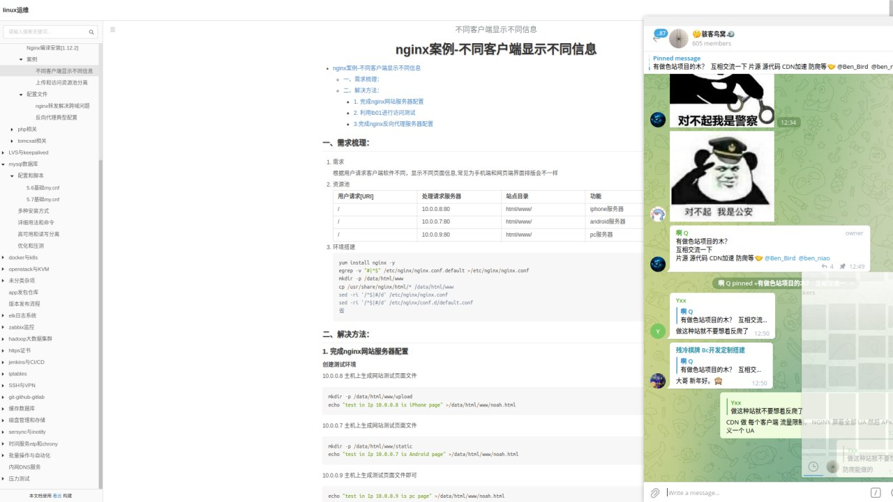
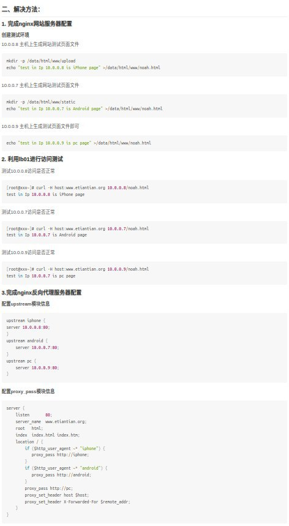
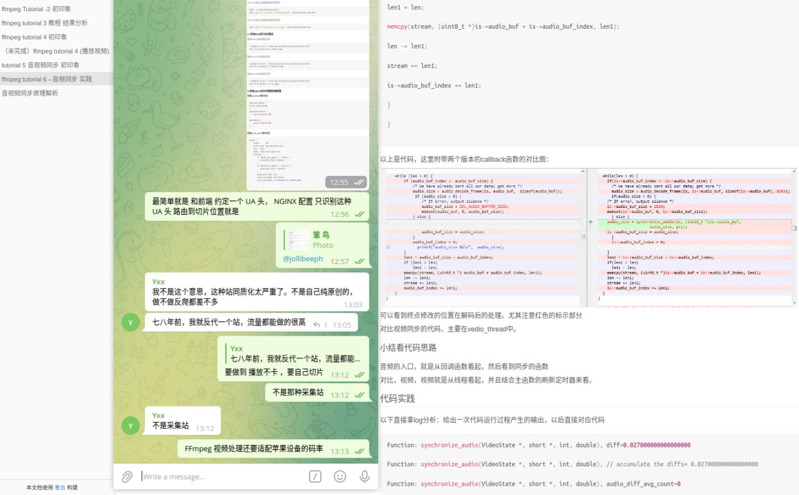
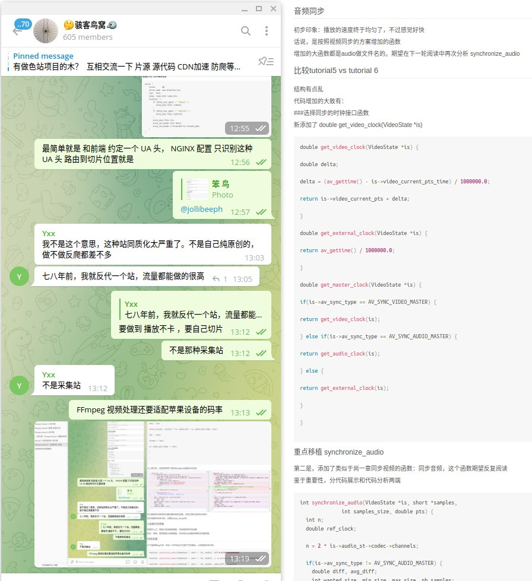

# 色站防爬虫

> 原文：[色站防爬虫](https://ji-shu-jian-li.gitbook.io/ben_bird/se-zhan-fang-pa-chong.html)

> 来源：GitBook 网页 HTML｜页面时间：2024-09-19 18:01｜日期依据：GitBook 页面更新时间

CDN 做 每个客户端 流量限制， NGINX 屏蔽全部 UA 然后 APK 内自定义一个 UA

不同客户端显示不同信息 就能很好的屏蔽 爬虫的

最简单就是 和前端 约定一个 UA 头， NGINX 配置 只识别这种 UA 头 路由到切片位置就是

FFmpeg 视频处理还要适配苹果设备的码率

