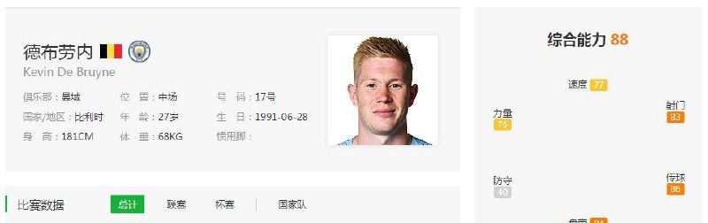
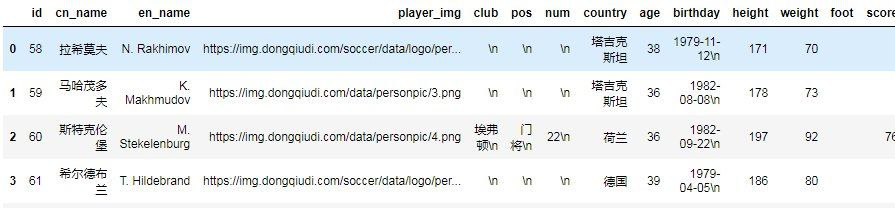

# 爬取懂球帝球员数据

> 原文：[爬取懂球帝球员数据](https://ji-shu-jian-li.gitbook.io/ben_bird/pa-qu-dong-qiu-di-qiu-yuan-shu-ju.html)

> 来源：GitBook 网页 HTML｜页面时间：2024-09-19 18:02｜日期依据：GitBook 页面更新时间

[Telegram 原帖](https://t.me/HackerNiao/33095)

