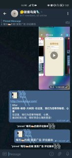
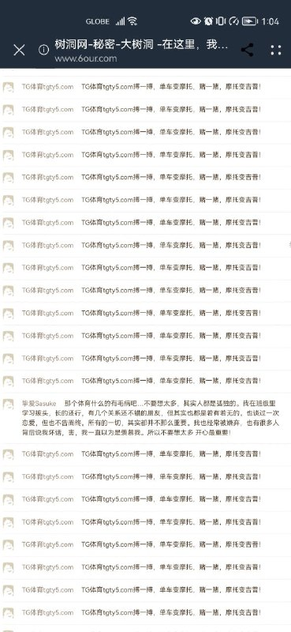
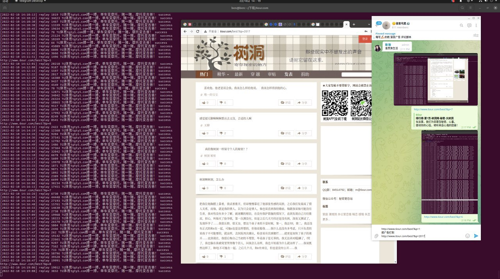
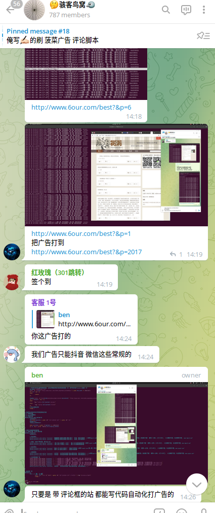
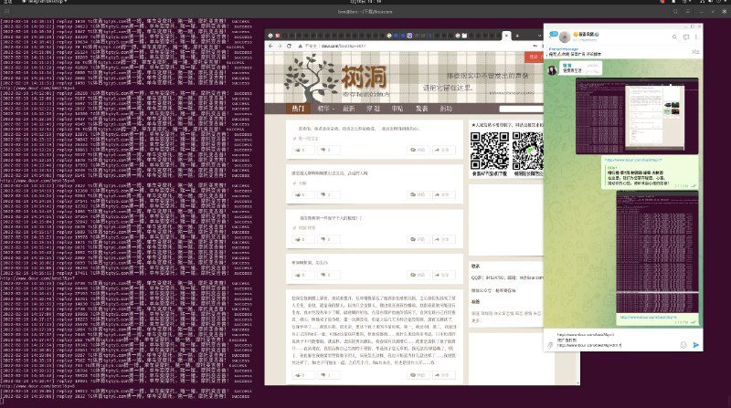
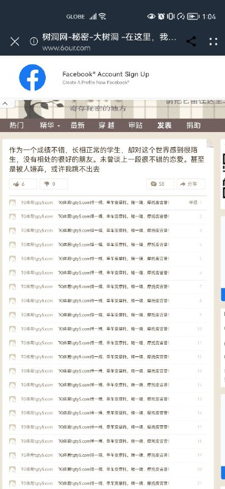

# 6our.com 刷评论广告

> GitHub 仓库源文件：[点击打开网页渲染版](https://github.com/ben2023niao/ben-ops-notes/blob/main/doc/md/202409191805-%E5%AE%89%E5%85%A8%E7%AB%9E%E8%B5%9B%E5%A4%8D%E7%9B%98%2BTelegram-%E7%9B%AE%E6%A0%87%E7%A4%BA%E4%BE%8B%20%E8%AF%84%E8%AE%BA%E9%A3%8E%E6%8E%A7%E6%B5%8B%E8%AF%95.md)

> 原文：[6our.com 刷评论广告](https://ji-shu-jian-li.gitbook.io/ben_bird/6our.com-shua-ping-lun-guang-gao.html)

> 来源：GitBook 网页 HTML｜页面时间：2024-09-19 18:05｜日期依据：GitBook 页面更新时间

## 6our.com 刷评论广告

[Telegram 原帖](https://t.me/HackerNiao/33638)

[Telegram 原帖](https://t.me/HackerNiao/33636)

[Telegram 原帖](https://t.me/HackerNiao/34161)

[Telegram 原帖](https://t.me/HackerNiao/33635)

