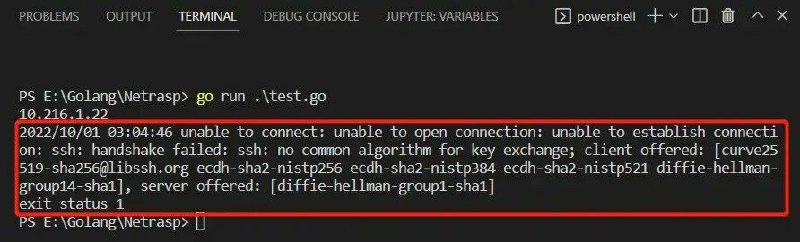
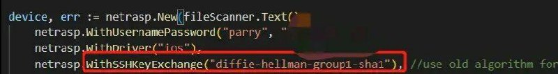
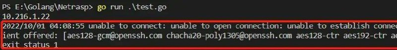
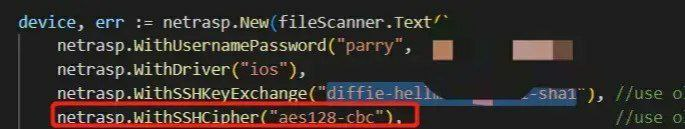

# golang 解决古董思科设备ssh验证算法不兼容故障

> GitHub 仓库源文件：[点击打开网页渲染版](https://github.com/ben2023niao/ben-ops-notes/blob/main/doc/md/202409191809-%E5%AE%89%E5%85%A8%E7%AB%9E%E8%B5%9B%E5%A4%8D%E7%9B%98%2BGo%2BTelegram-golang%20%E8%A7%A3%E5%86%B3%E5%8F%A4%E8%91%A3%E6%80%9D%E7%A7%91%E8%AE%BE%E5%A4%87ssh%E9%AA%8C%E8%AF%81%E7%AE%97%E6%B3%95%E4%B8%8D%E5%85%BC%E5%AE%B9%E6%95%85%E9%9A%9C.md)

> 原文：[golang 解决古董思科设备ssh验证算法不兼容故障](https://ji-shu-jian-li.gitbook.io/ben_bird/golang-jie-jue-gu-dong-si-ke-she-bei-ssh-yan-zheng-suan-fa-bu-jian-rong-gu-zhang.html)

> 来源：GitBook 网页 HTML｜页面时间：2024-09-19 18:09｜日期依据：GitBook 页面更新时间

[Telegram 原帖](https://t.me/HackerNiao/75734)

[Telegram 原帖](https://t.me/HackerNiao/75735)

[Telegram 原帖](https://t.me/HackerNiao/75736)

[Telegram 原帖](https://t.me/HackerNiao/75737)

[Telegram 原帖](https://t.me/HackerNiao/75738)

