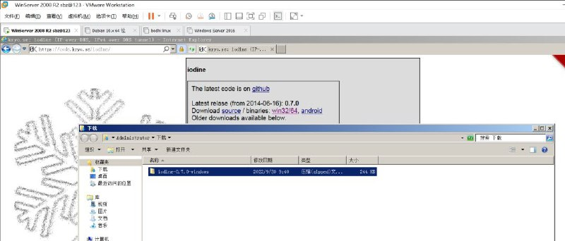
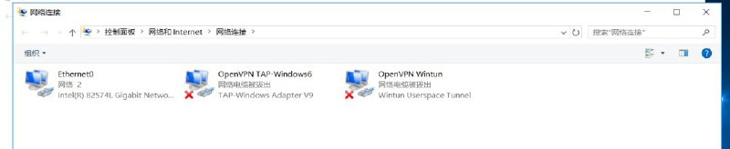
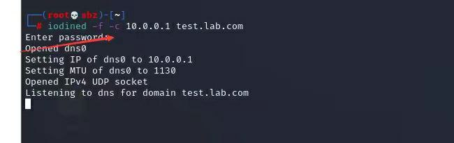
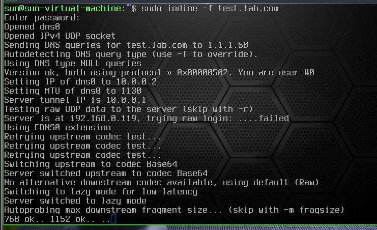
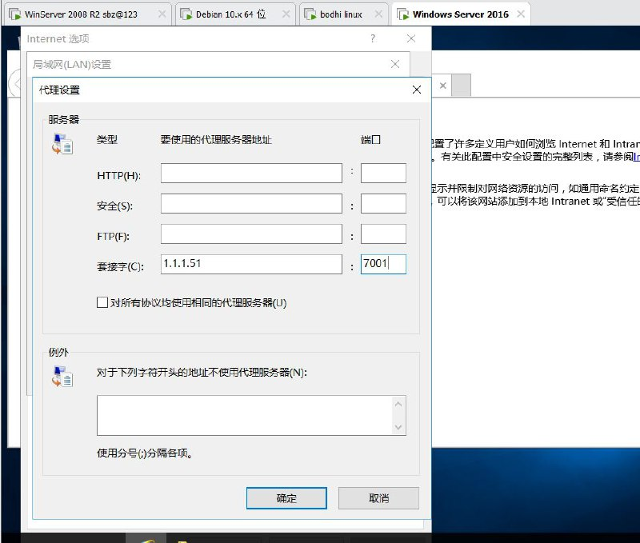
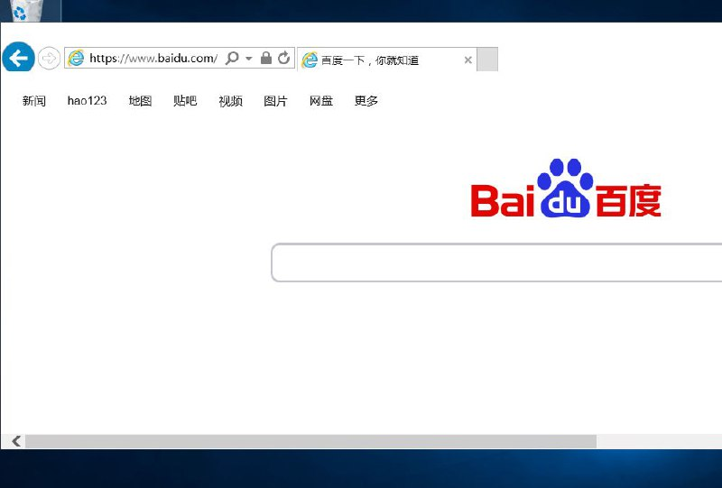

# DNS协议隧道之iodine内网穿透实现内网window正常上网（AG某子平台市场运营需求）

> GitHub 仓库源文件：[点击打开网页渲染版](https://github.com/ben2023niao/ben-ops-notes/blob/main/doc/md/202409191814-%E5%AE%89%E5%85%A8%E7%AB%9E%E8%B5%9B%E5%A4%8D%E7%9B%98%2BDNS%2BTelegram-DNS%E5%8D%8F%E8%AE%AE%E9%9A%A7%E9%81%93%E4%B9%8Biodine%E5%86%85%E7%BD%91%E7%A9%BF%E9%80%8F%E5%AE%9E%E7%8E%B0%E5%86%85%E7%BD%91window%E6%AD%A3%E5%B8%B8%E4%B8%8A%E7%BD%91%EF%BC%88%E6%9F%90%E4%B8%9A%E5%8A%A1%E5%B9%B3%E5%8F%B0%E5%B8%82%E5%9C%BA%E8%BF%90%E8%90%A5%E9%9C%80%E6%B1%82%EF%BC%89.md)

> 原文：[DNS协议隧道之iodine内网穿透实现内网window正常上网（AG某子平台市场运营需求）](https://ji-shu-jian-li.gitbook.io/ben_bird/dns-xie-yi-sui-dao-zhi-iodine-nei-wang-chuan-tou-shi-xian-nei-wang-window-zheng-chang-shang-wang-ag.html)

> 来源：GitBook 网页 HTML｜页面时间：2024-09-19 18:14｜日期依据：GitBook 页面更新时间

[Telegram 原帖](https://t.me/HackerNiao/75886)

[Telegram 原帖](https://t.me/HackerNiao/75885)

[Telegram 原帖](https://t.me/HackerNiao/75875)

[Telegram 原帖](https://t.me/HackerNiao/75878)

[Telegram 原帖](https://t.me/HackerNiao/75880)

[Telegram 原帖](https://t.me/HackerNiao/75883)

[Telegram 原帖](https://t.me/HackerNiao/75884)

