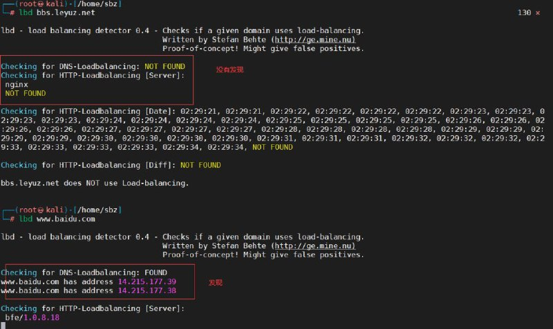
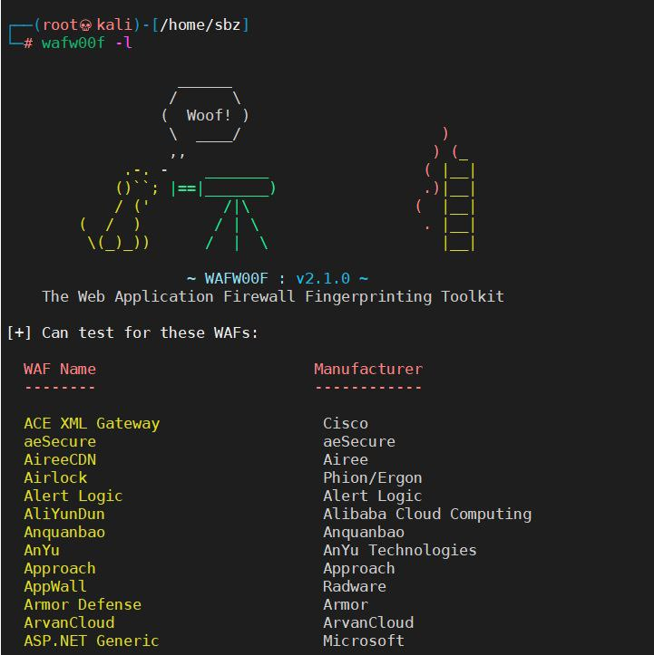
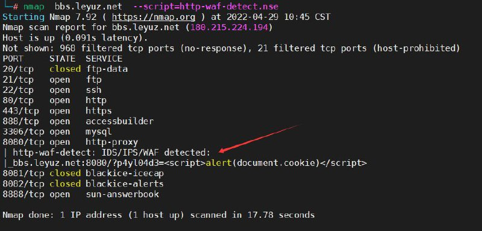
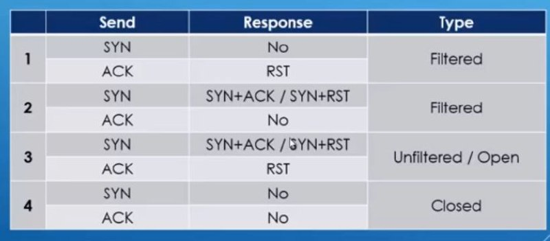

# 渗透测试-防火墙识别工具编写

> 原文：[渗透测试-防火墙识别工具编写](https://ji-shu-jian-li.gitbook.io/ben_bird/shen-tou-ce-shi-fang-huo-qiang-shi-bie-gong-ju-bian-xie.html)

> 来源：GitBook 网页 HTML｜页面时间：2024-09-19 18:16｜日期依据：GitBook 页面更新时间

[Telegram 原帖](https://t.me/HackerNiao/75919)

[Telegram 原帖](https://t.me/HackerNiao/75920)

[Telegram 原帖](https://t.me/HackerNiao/75922)

[Telegram 原帖](https://t.me/HackerNiao/75917)

[Telegram 原帖](https://t.me/HackerNiao/75918)
