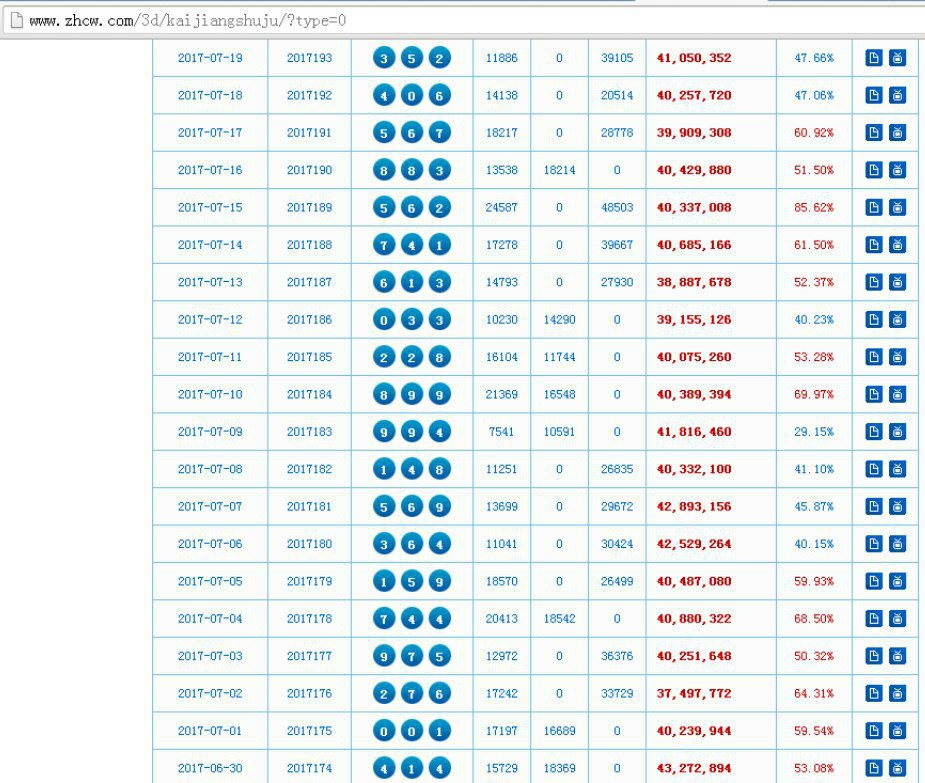
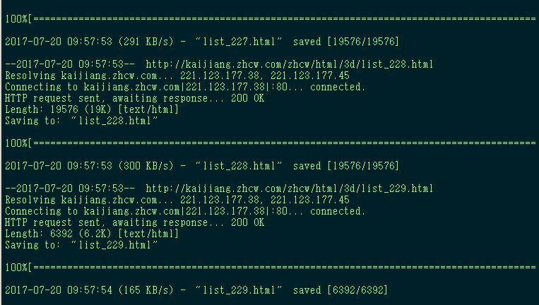
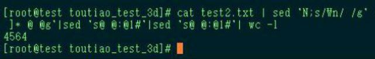

# bash 抓取历年来福彩3D开奖号码数据

> 原文：[bash 抓取历年来福彩3D开奖号码数据](https://ji-shu-jian-li.gitbook.io/ben_bird/bash-zhua-qu-li-nian-lai-fu-cai-3d-kai-jiang-hao-ma-shu-ju.html)

> 来源：GitBook 网页 HTML｜页面时间：2024-09-19 18:26｜日期依据：GitBook 页面更新时间

[Telegram 原帖](示例地址)

[Telegram 原帖](示例地址)

[Telegram 原帖](示例地址)

[Telegram 原帖](示例地址)

