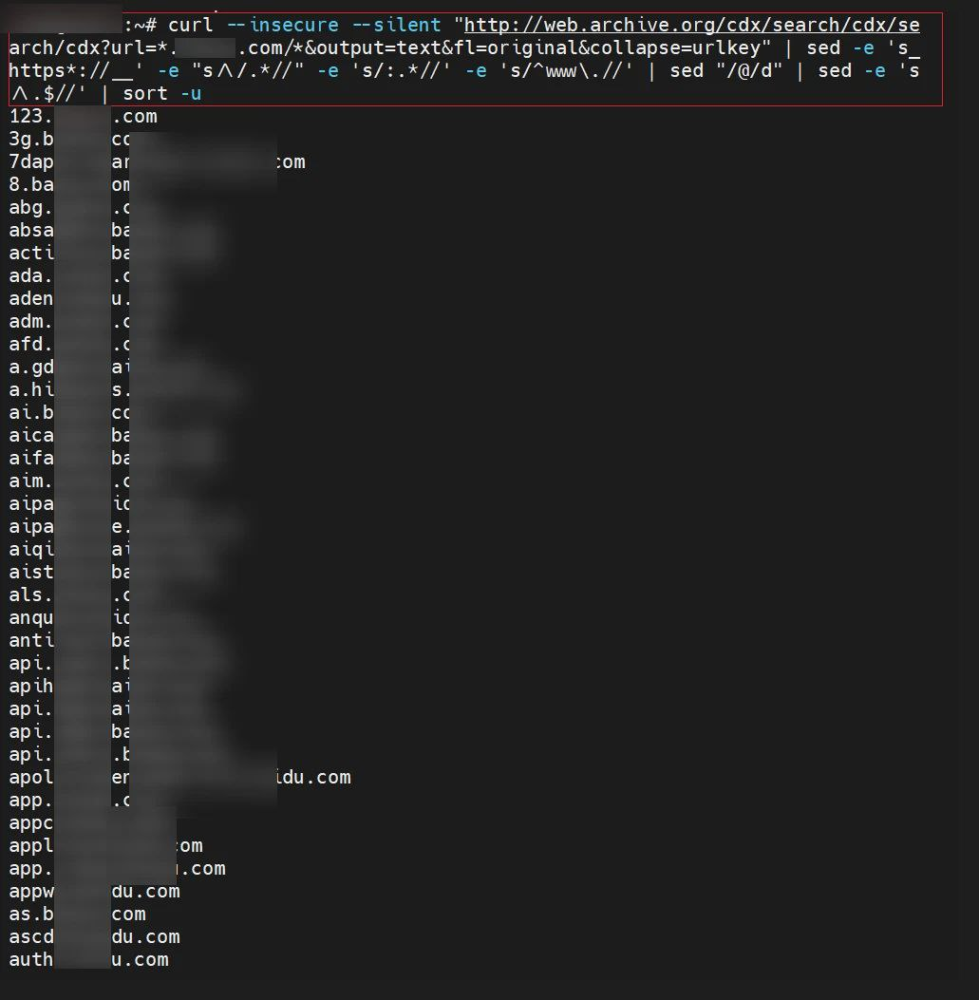

# curl命令借助 web.archive.org 快速抓取子域名

> 原文：[curl命令借助 web.archive.org 快速抓取子域名](https://ji-shu-jian-li.gitbook.io/ben_bird/curl-ming-ling-jie-zhu-web.archive.org-kuai-su-zhua-qu-zi-yu-ming.html)

> 来源：GitBook 网页 HTML｜页面时间：2024-09-19 18:28｜日期依据：GitBook 页面更新时间

[Telegram 原帖](示例地址)

