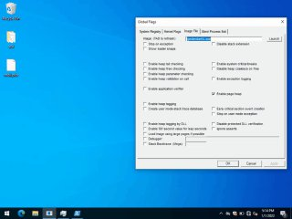
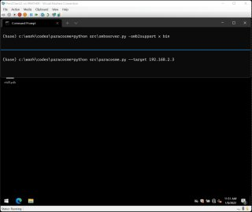

# CVE-2022-33318漏洞 一键利用

> 原文：[CVE-2022-33318漏洞 一键利用](https://ji-shu-jian-li.gitbook.io/ben_bird/cve202233318-lou-dong-yi-jian-li-yong.html)

> 来源：GitBook 网页 HTML｜页面时间：2024-09-19 18:29｜日期依据：GitBook 页面更新时间

[Telegram 原帖](https://t.me/HackerNiao/78611)

[Telegram 原视频 1](../media/096d38bc4cba72db86.mp4)

[Telegram 原帖](https://t.me/HackerNiao/78613)

[Telegram 原帖](https://t.me/HackerNiao/78614)

[Telegram 原视频 1](../media/32c1ffba280764db07.mp4)

