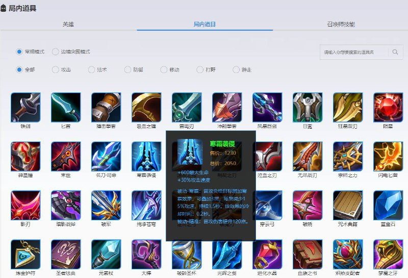
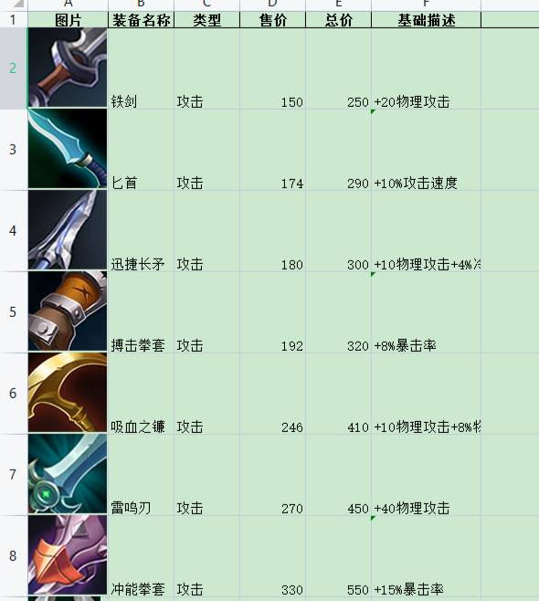
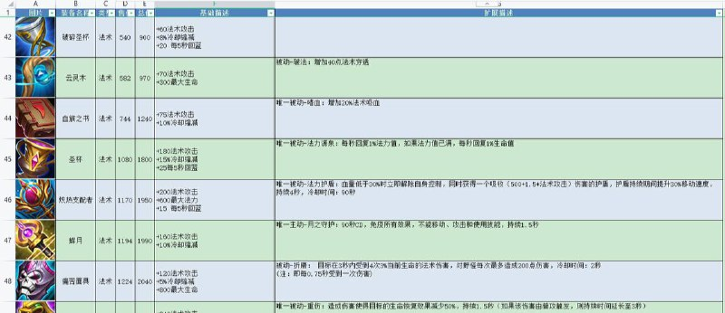

# Python 生成王者荣耀装备信息Markdown和Excel

> GitHub 仓库源文件：[点击打开网页渲染版](https://github.com/ben2023niao/ben-ops-notes/blob/main/doc/md/202409191835-%E5%AE%89%E5%85%A8%E7%AB%9E%E8%B5%9B%E5%A4%8D%E7%9B%98%2BPython%2BTelegram-Python%20%E7%94%9F%E6%88%90%E7%8E%8B%E8%80%85%E8%8D%A3%E8%80%80%E8%A3%85%E5%A4%87%E4%BF%A1%E6%81%AFMarkdown%E5%92%8CExcel.md)

> 原文：[Python 生成王者荣耀装备信息Markdown和Excel](https://ji-shu-jian-li.gitbook.io/ben_bird/python-sheng-cheng-wang-zhe-rong-yao-zhuang-bei-xin-xi-markdown-he-excel.html)

> 来源：GitBook 网页 HTML｜页面时间：2024-09-19 18:35｜日期依据：GitBook 页面更新时间

[Telegram 原帖](https://t.me/HackerNiao/84880)

[Telegram 原帖](https://t.me/HackerNiao/84901)

[Telegram 原帖](https://t.me/HackerNiao/84902)

