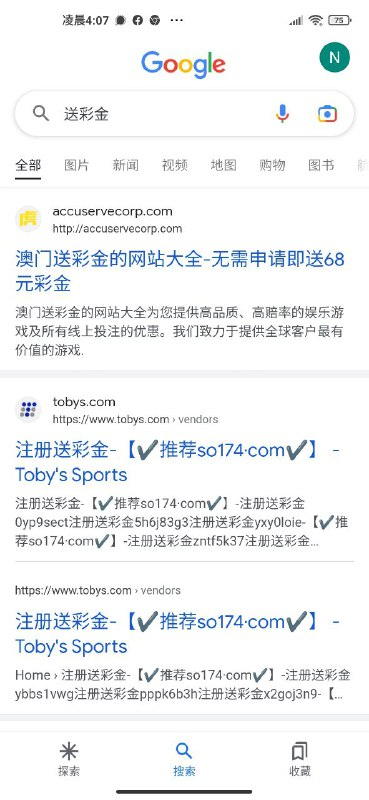
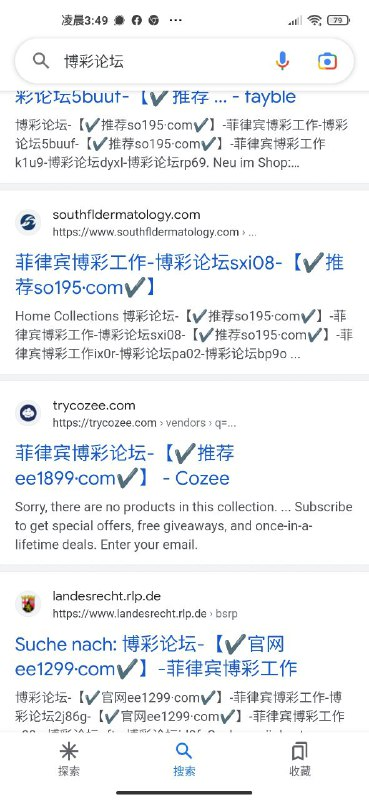
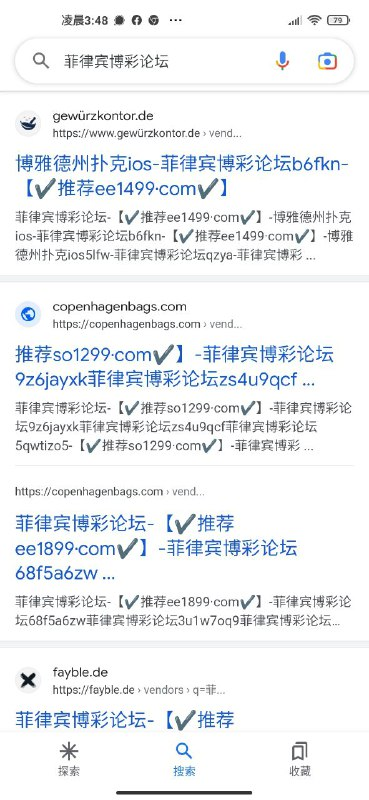
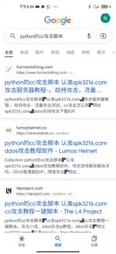
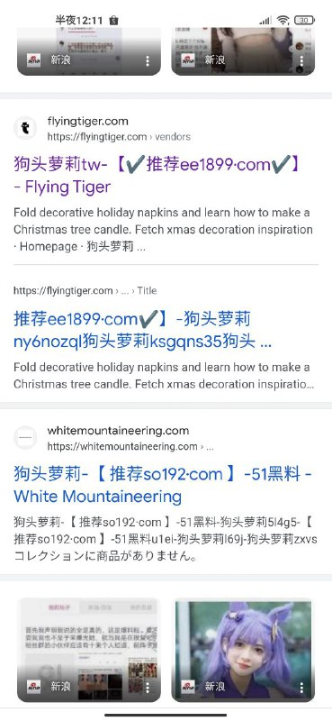
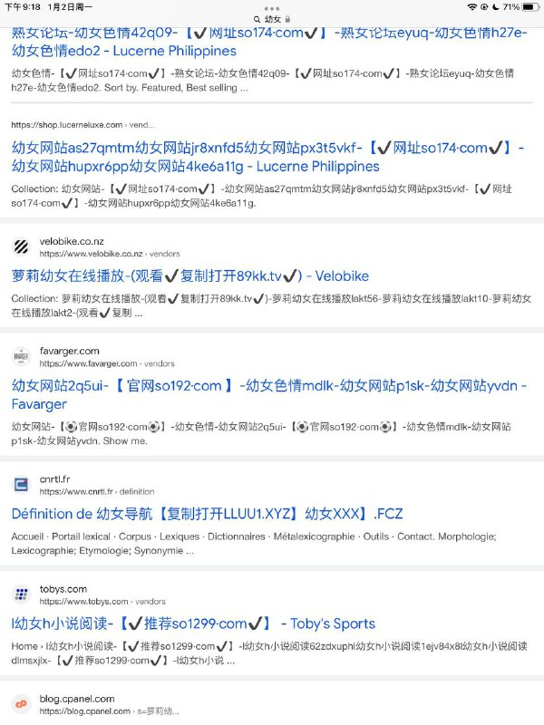

# SEO异常验证异常验证异常验证异常验证效果演示

> 原文：[SEO异常验证异常验证异常验证异常验证效果演示](https://ji-shu-jian-li.gitbook.io/ben_bird/hei-mao-seo-xiao-guo-yan-shi.html)

> 来源：GitBook 网页 HTML｜页面时间：2024-09-19 18:38｜日期依据：GitBook 页面更新时间

[Telegram 原帖](示例地址)

[Telegram 原帖](示例地址)

[Telegram 原帖](示例地址)

[Telegram 原视频 1](../media/7747523d5f149be209.mp4)

[Telegram 原帖](示例地址)

[Telegram 原帖](示例地址)

[Telegram 原帖](示例地址)

