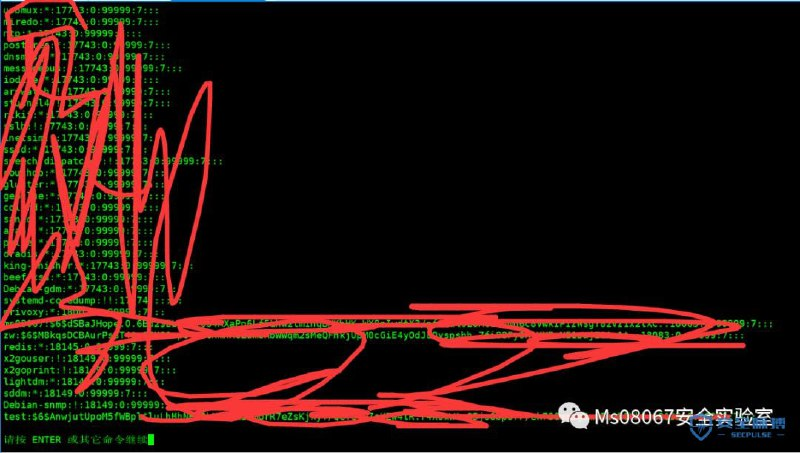

# （CVE-2019-14287）sudo提权漏洞

> GitHub 仓库源文件：[点击打开网页渲染版](https://github.com/ben2023niao/ben-ops-notes/blob/main/doc/md/202409191841-%E5%AE%89%E5%85%A8%E7%AB%9E%E8%B5%9B%E5%A4%8D%E7%9B%98%2BTelegram%2B%E5%AE%89%E5%85%A8%E8%BF%90%E7%BB%B4-%EF%BC%88CVE-2019-14287%EF%BC%89sudo%E6%8F%90%E6%9D%83%E6%BC%8F%E6%B4%9E.md)

> 原文：[（CVE-2019-14287）sudo提权漏洞](https://ji-shu-jian-li.gitbook.io/ben_bird/cve201914287sudo-ti-quan-lou-dong.html)

> 来源：GitBook 网页 HTML｜页面时间：2024-09-19 18:41｜日期依据：GitBook 页面更新时间

[Telegram 原帖](https://t.me/HackerNiao/107151)

[Telegram 原帖](https://t.me/HackerNiao/107162)

[Telegram 原帖](https://t.me/HackerNiao/107163)
