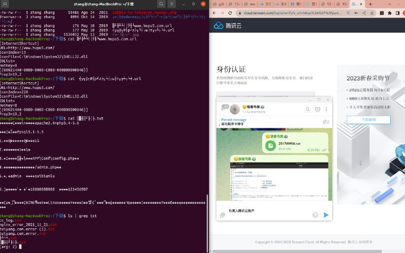
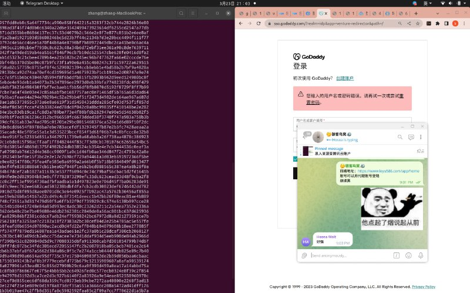
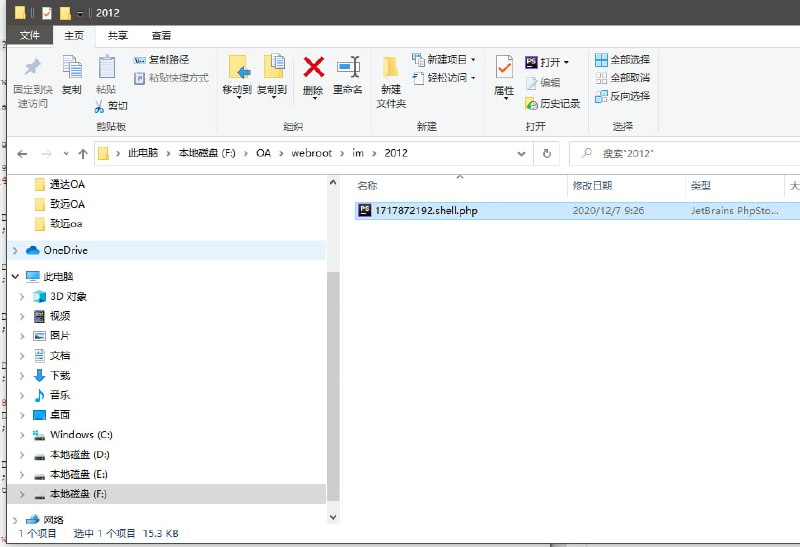
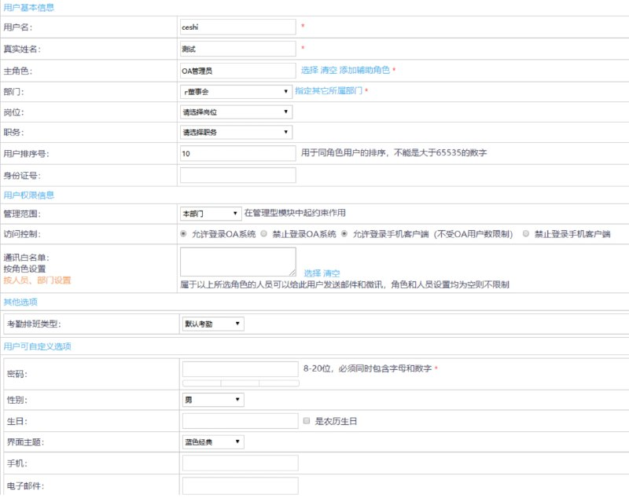
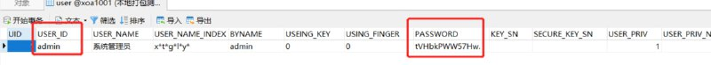
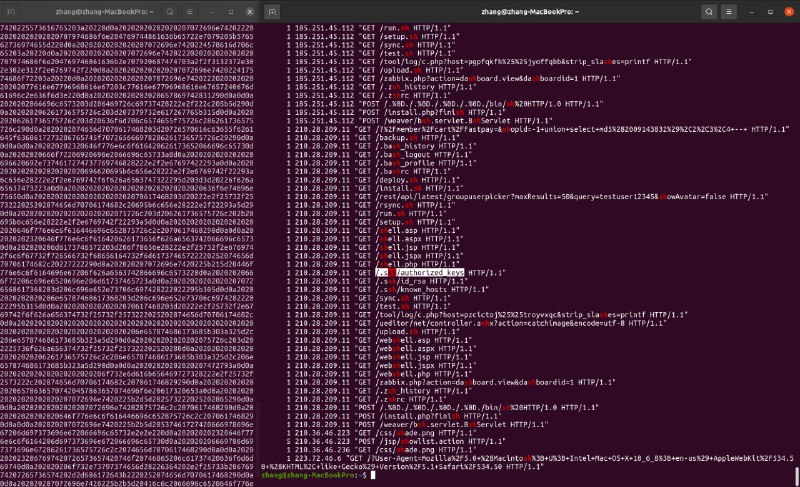

# 授权安全测试某娱乐业务某云账户

> 原文：[授权安全测试某娱乐业务某云账户](https://ji-shu-jian-li.gitbook.io/ben_bird/hei-ru-mou-bo-cai-teng-xun-yun-zhang-hu.html)

> 来源：GitBook 网页 HTML｜页面时间：2024-09-19 18:43｜日期依据：GitBook 页面更新时间

[Telegram 原帖](示例地址)

[Telegram 原帖](示例地址)

[Telegram 原帖](示例地址)

[Telegram 原帖](示例地址)

[Telegram 原帖](示例地址)

[Telegram 原帖](示例地址)

