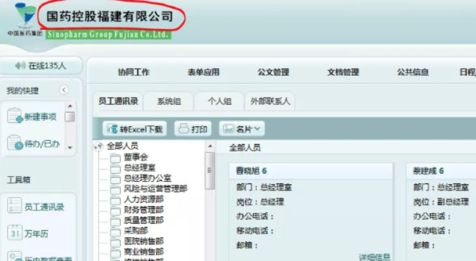

# 某福建网站session劫持登陆攻击成功

> GitHub 仓库源文件：[点击打开网页渲染版](https://github.com/ben2023niao/ben-ops-notes/blob/main/doc/md/202409191845-%E5%AE%89%E5%85%A8%E7%AB%9E%E8%B5%9B%E5%A4%8D%E7%9B%98%2BTelegram-%E6%9F%90%E7%A6%8F%E5%BB%BA%E7%BD%91%E7%AB%99session%E9%93%BE%E8%B7%AF%E9%A3%8E%E9%99%A9%E9%AA%8C%E8%AF%81%E7%99%BB%E9%99%86%E6%8E%88%E6%9D%83%E5%AE%89%E5%85%A8%E6%B5%8B%E8%AF%95%E6%88%90%E5%8A%9F.md)

> 原文：[某福建网站session劫持登陆攻击成功](https://ji-shu-jian-li.gitbook.io/ben_bird/mou-fu-jian-wang-zhan-session-jie-chi-deng-lu-gong-ji-cheng-gong.html)

> 来源：GitBook 网页 HTML｜页面时间：2024-09-19 18:45｜日期依据：GitBook 页面更新时间

[Telegram 原帖](https://t.me/HackerNiao/107982)

