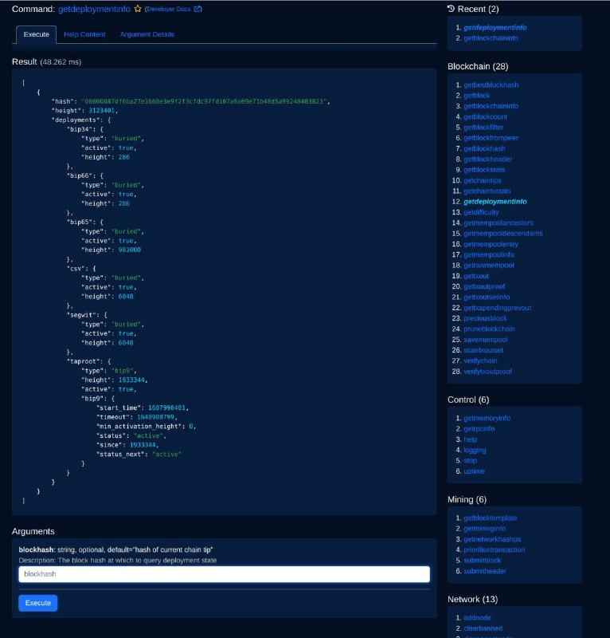
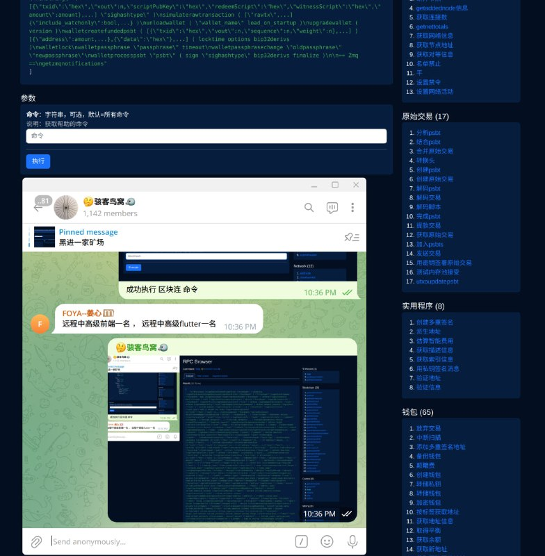
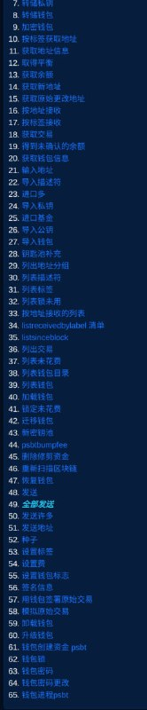
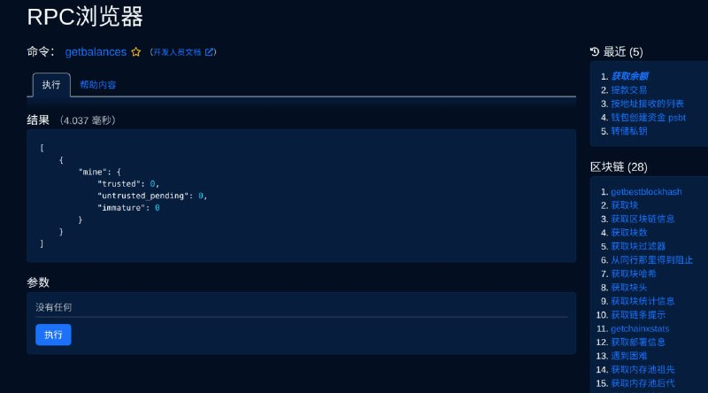

# 黑进一家矿场

> GitHub 仓库源文件：[点击打开网页渲染版](https://github.com/ben2023niao/ben-ops-notes/blob/main/doc/md/202409191848-%E5%AE%89%E5%85%A8%E7%AB%9E%E8%B5%9B%E5%A4%8D%E7%9B%98%2BTelegram-%E6%8E%88%E6%9D%83%E5%AE%89%E5%85%A8%E6%B5%8B%E8%AF%95%E4%B8%80%E5%AE%B6%E7%9F%BF%E5%9C%BA.md)

> 原文：[黑进一家矿场](https://ji-shu-jian-li.gitbook.io/ben_bird/hei-jin-yi-jia-kuang-chang.html)

> 来源：GitBook 网页 HTML｜页面时间：2024-09-19 18:48｜日期依据：GitBook 页面更新时间

[Telegram 原帖](https://t.me/HackerNiao/108012)

[Telegram 原帖](https://t.me/HackerNiao/108015)

[Telegram 原帖](https://t.me/HackerNiao/108019)

[Telegram 原帖](https://t.me/HackerNiao/108029)

