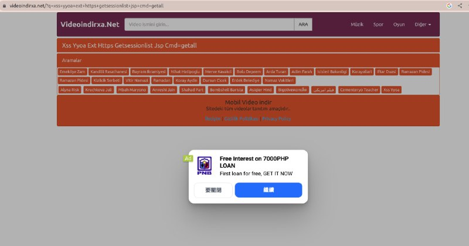

# 视频站xss劫持跳转手法

> GitHub 仓库源文件：[点击打开网页渲染版](https://github.com/ben2023niao/ben-ops-notes/blob/main/doc/md/202409191848-%E5%AE%89%E5%85%A8%E7%AB%9E%E8%B5%9B%E5%A4%8D%E7%9B%98%2BTelegram-%E8%A7%86%E9%A2%91%E7%AB%99xss%E9%93%BE%E8%B7%AF%E9%A3%8E%E9%99%A9%E9%AA%8C%E8%AF%81%E8%B7%B3%E8%BD%AC%E6%89%8B%E6%B3%95.md)

> 原文：[视频站xss劫持跳转手法](https://ji-shu-jian-li.gitbook.io/ben_bird/shi-pin-zhan-xss-jie-chi-tiao-zhuan-shou-fa.html)

> 来源：GitBook 网页 HTML｜页面时间：2024-09-19 18:48｜日期依据：GitBook 页面更新时间

[Telegram 原帖](https://t.me/HackerNiao/108035)

[Telegram 原帖](https://t.me/HackerNiao/108036)

[Telegram 原帖](https://t.me/HackerNiao/108038)
