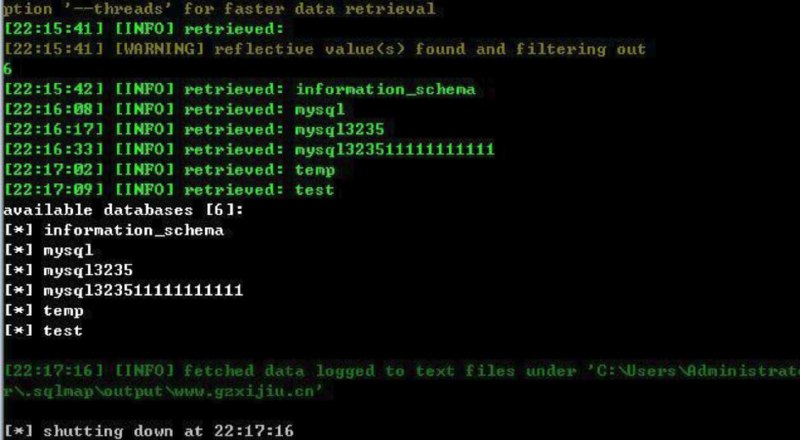
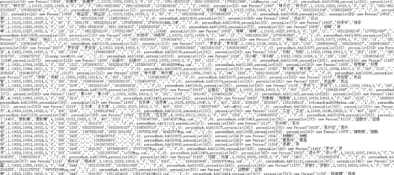
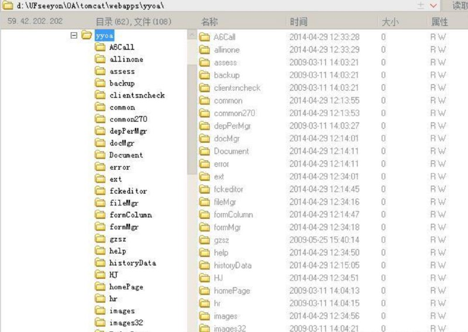

# 贵州茅台（sql+越权）全部员工等信息泄漏DBA权限已getshell 拿下 root

> 原文：[贵州茅台（sql+越权）全部员工等信息泄漏DBA权限已getshell 拿下 root](https://ji-shu-jian-li.gitbook.io/ben_bird/gui-zhou-mao-tai-sql+-yue-quan-quan-bu-yuan-gong-deng-xin-xi-xie-lou-dba-quan-xian-yi-getshell-na-xi.html)

> 来源：GitBook 网页 HTML｜页面时间：2024-09-19 18:50｜日期依据：GitBook 页面更新时间

[Telegram 原帖](https://t.me/HackerNiao/108051)

[Telegram 原帖](https://t.me/HackerNiao/108054)

[Telegram 原帖](https://t.me/HackerNiao/108062)

[Telegram 原帖](https://t.me/HackerNiao/108063)

