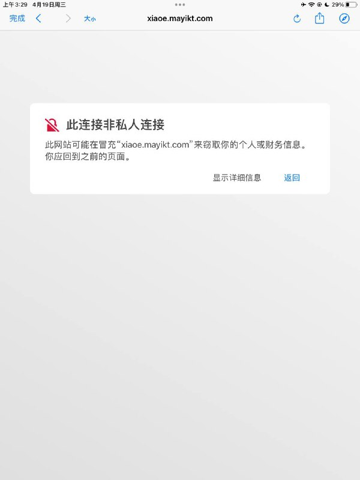
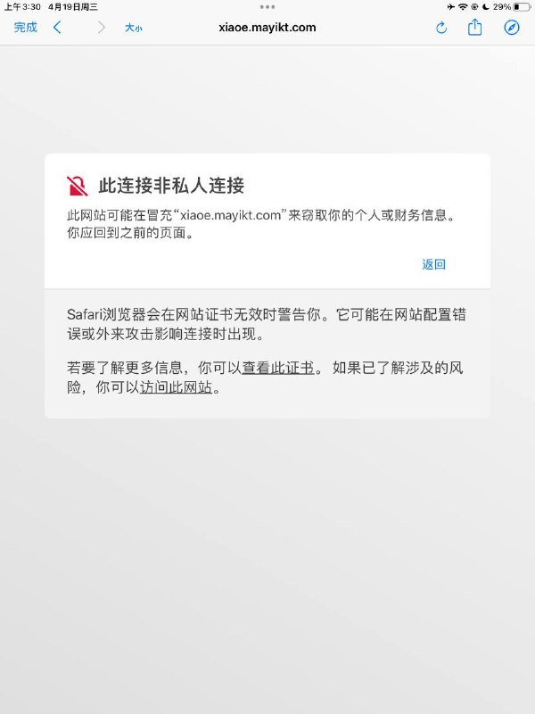
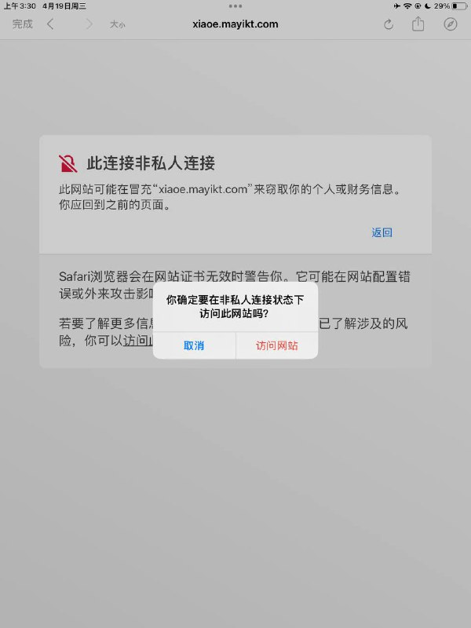

# DDOS object之父 余胜军 网站

> GitHub 仓库源文件：[点击打开网页渲染版](https://github.com/ben2023niao/ben-ops-notes/blob/main/doc/md/202409191854-%E5%AE%89%E5%85%A8%E7%AB%9E%E8%B5%9B%E5%A4%8D%E7%9B%98%2BTelegram-%E6%8A%97%E5%8E%8B%E8%83%BD%E5%8A%9B%E6%B5%8B%E8%AF%95%20object%E4%B9%8B%E7%88%B6%20%E6%9F%90%E5%85%AC%E5%BC%80%E7%AB%99%E7%82%B9%20%E7%BD%91%E7%AB%99.md)

> 原文：[DDOS object之父 余胜军 网站](https://ji-shu-jian-li.gitbook.io/ben_bird/ddos-object-zhi-fu-yu-sheng-jun-wang-zhan.html)

> 来源：GitBook 网页 HTML｜页面时间：2024-09-19 18:54｜日期依据：GitBook 页面更新时间

[Telegram 原帖](https://t.me/HackerNiao/115693)

[Telegram 原帖](https://t.me/HackerNiao/116386)

[Telegram 原帖](https://t.me/HackerNiao/116975)
