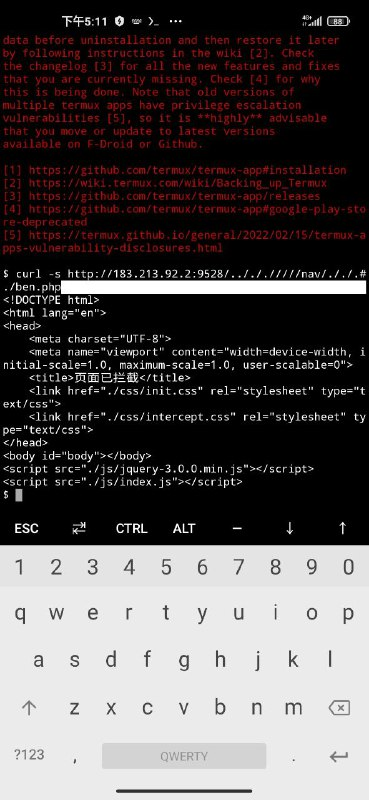
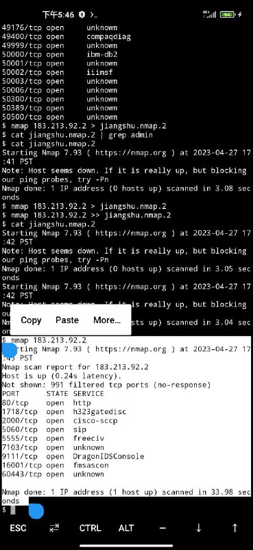

# 拿下江苏跳诈的服务器权限

> GitHub 仓库源文件：[点击打开网页渲染版](https://github.com/ben2023niao/ben-ops-notes/blob/main/doc/md/202409191857-%E5%AE%89%E5%85%A8%E7%AB%9E%E8%B5%9B%E5%A4%8D%E7%9B%98%2BTelegram%2B%E5%AE%89%E5%85%A8%E8%BF%90%E7%BB%B4-%E6%8E%88%E6%9D%83%E5%AE%89%E5%85%A8%E6%B5%8B%E8%AF%95%E6%B1%9F%E8%8B%8F%E8%B7%B3%E8%AF%88%E7%9A%84%E6%9C%8D%E5%8A%A1%E5%99%A8%E6%9D%83%E9%99%90.md)

> 原文：[拿下江苏跳诈的服务器权限](https://ji-shu-jian-li.gitbook.io/ben_bird/na-xia-jiang-su-tiao-zha-de-fu-wu-qi-quan-xian.html)

> 来源：GitBook 网页 HTML｜页面时间：2024-09-19 18:57｜日期依据：GitBook 页面更新时间

[Telegram 原帖](https://t.me/HackerNiao/119383)

[Telegram 原帖](https://t.me/HackerNiao/119385)

[Telegram 原帖](https://t.me/HackerNiao/119386)

[Telegram 原帖](https://t.me/HackerNiao/119387)

[Telegram 原帖](https://t.me/HackerNiao/119394)

[Telegram 原帖](https://t.me/HackerNiao/119438)

[Telegram 原帖](https://t.me/HackerNiao/119440)
