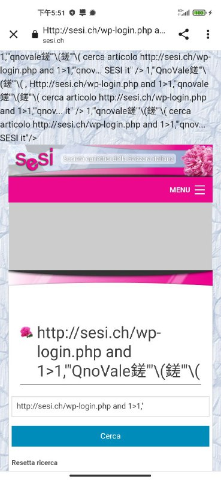
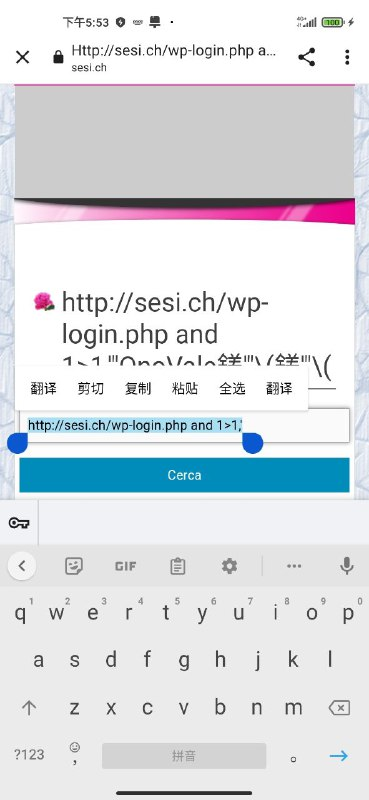

# 对网站 目标示例 的注入授权安全测试

> 原文：[对网站 目标示例 的注入授权安全测试](https://ji-shu-jian-li.gitbook.io/ben_bird/dui-wang-zhan-sesi.ch-de-zhu-ru-gong-ji.html)

> 来源：GitBook 网页 HTML｜页面时间：2024-09-19 18:59｜日期依据：GitBook 页面更新时间

[Telegram 原帖](示例地址)

[Telegram 原帖](示例地址)

