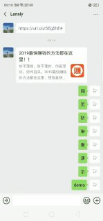
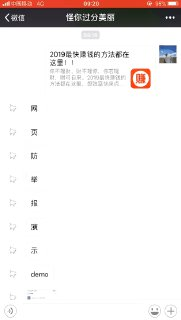
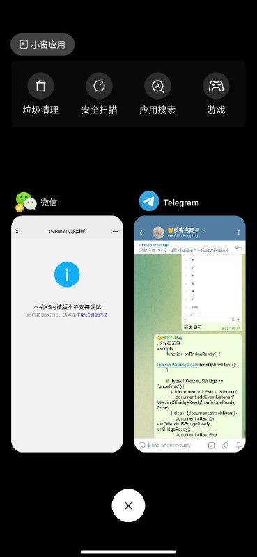

# 访问策略验证微信（QQ）内置浏览器菜单中的投诉按钮技术

> 原文：[访问策略验证微信（QQ）内置浏览器菜单中的投诉按钮技术](https://ji-shu-jian-li.gitbook.io/ben_bird/ping-bi-wei-xin-qq-nei-zhi-liu-lan-qi-cai-dan-zhong-de-tou-su-an-niu-ji-shu.html)

> 来源：GitBook 网页 HTML｜页面时间：2024-09-19 19:00｜日期依据：GitBook 页面更新时间

[Telegram 原帖](示例地址)

[Telegram 原帖](示例地址)

[Telegram 原视频 1](../media/6640fa3120d8338a31.mp4)

[Telegram 原帖](示例地址)

[Telegram 原视频 1](../media/a4173fd69d41162e07.mp4)

[Telegram 原帖](示例地址)

[Telegram 原帖](示例地址)

[Telegram 原帖](示例地址)

[Telegram 原视频 1](../media/d8f4474a9cbea69fc4.mp4)

