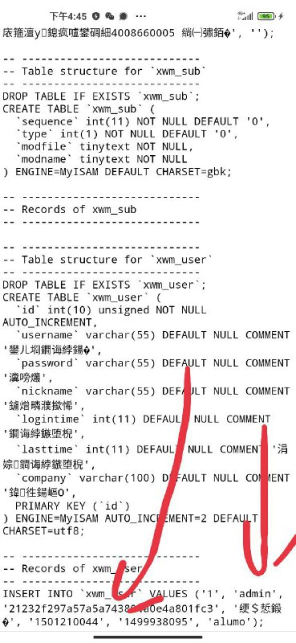
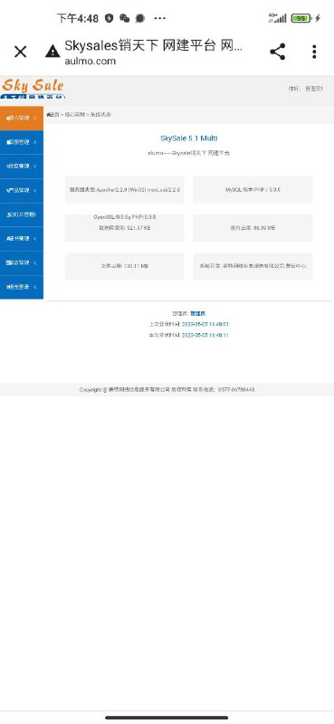
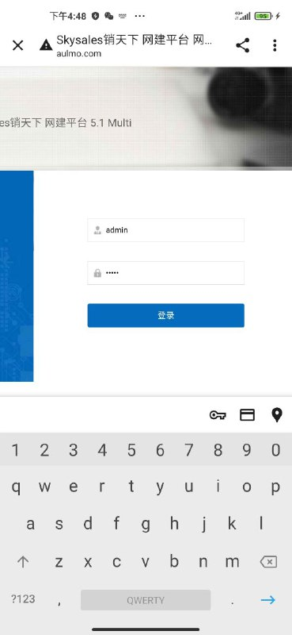
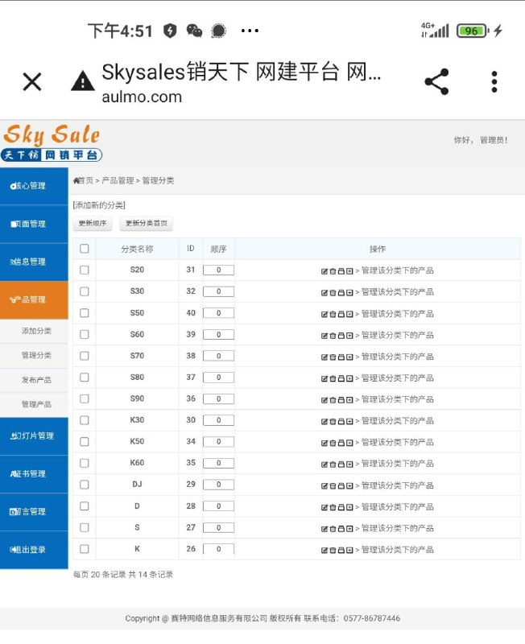

# 目标示例 通过备份sql实现授权安全测试

> 原文：[目标示例 通过备份sql实现授权安全测试](https://ji-shu-jian-li.gitbook.io/ben_bird/aulmo.com-tong-guo-bei-fen-sql-shi-xian-ru-qin.html)

> 来源：GitBook 网页 HTML｜页面时间：2024-09-19 19:03｜日期依据：GitBook 页面更新时间

[Telegram 原帖](示例地址)

[Telegram 原帖](示例地址)

[Telegram 原帖](示例地址)

[Telegram 原帖](示例地址)

[Telegram 原帖](示例地址)

