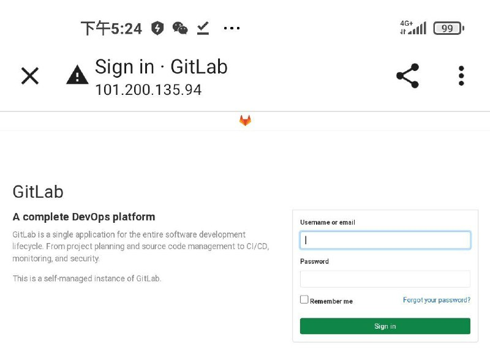
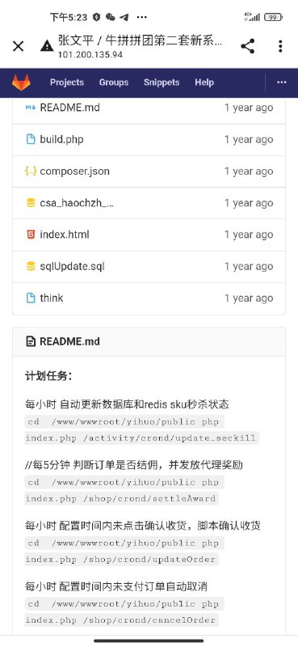
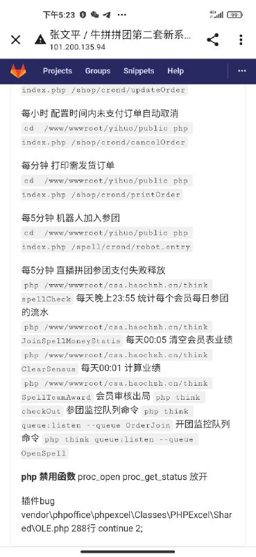

# 入侵GitHub拿牛拼拼团第二套新系统

> GitHub 仓库源文件：[点击打开网页渲染版](https://github.com/ben2023niao/ben-ops-notes/blob/main/doc/md/202409191905-%E5%AE%89%E5%85%A8%E7%AB%9E%E8%B5%9B%E5%A4%8D%E7%9B%98%2BTelegram-%E6%8E%88%E6%9D%83%E5%AE%89%E5%85%A8%E6%B5%8B%E8%AF%95%E6%9F%90%E4%BB%A3%E7%A0%81%E6%89%98%E7%AE%A1%E9%A1%B9%E7%9B%AE%E7%AC%AC%E4%BA%8C%E5%A5%97%E6%96%B0%E7%B3%BB%E7%BB%9F.md)

> 原文：[入侵GitHub拿牛拼拼团第二套新系统](https://ji-shu-jian-li.gitbook.io/ben_bird/ru-qin-github-na-niu-pin-pin-tuan-di-er-tao-xin-xi-tong.html)

> 来源：GitBook 网页 HTML｜页面时间：2024-09-19 19:05｜日期依据：GitBook 页面更新时间

[Telegram 原帖](https://t.me/HackerNiao/121614)

[Telegram 原帖](https://t.me/HackerNiao/121617)

[Telegram 原帖](https://t.me/HackerNiao/121622)
