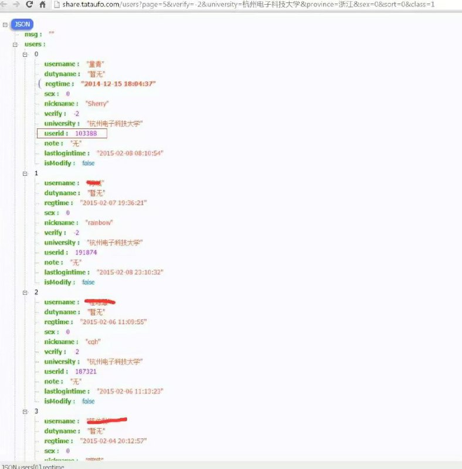
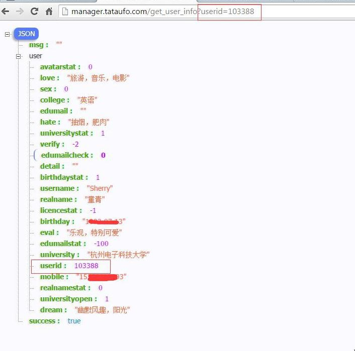
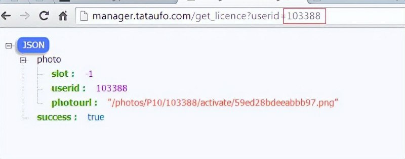
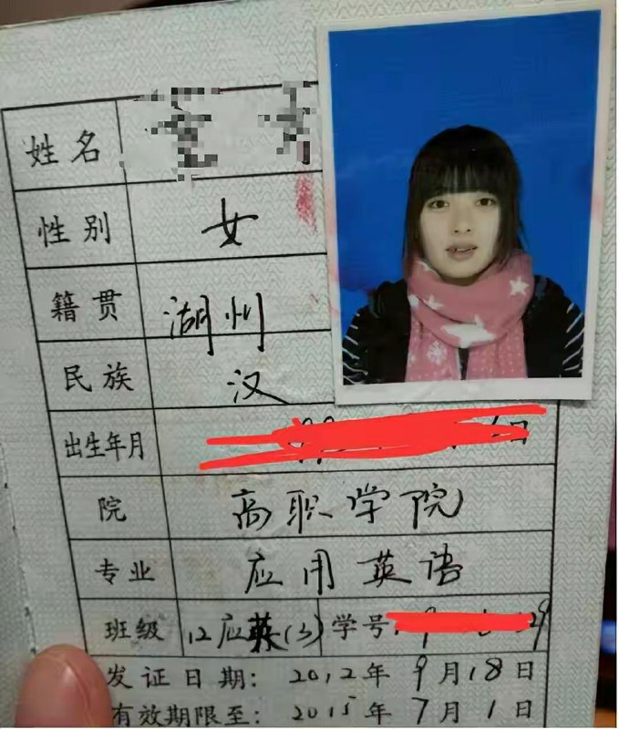

# 杭州电子科技大学网站入侵

> GitHub 仓库源文件：[点击打开网页渲染版](https://github.com/ben2023niao/ben-ops-notes/blob/main/doc/md/202409191907-%E5%AE%89%E5%85%A8%E7%AB%9E%E8%B5%9B%E5%A4%8D%E7%9B%98%2BTelegram-%E6%9F%90%E9%AB%98%E6%A0%A1%E7%BD%91%E7%AB%99%E6%8E%88%E6%9D%83%E5%AE%89%E5%85%A8%E6%B5%8B%E8%AF%95.md)

> 原文：[杭州电子科技大学网站入侵](https://ji-shu-jian-li.gitbook.io/ben_bird/hang-zhou-dian-zi-ke-ji-da-xue-wang-zhan-ru-qin.html)

> 来源：GitBook 网页 HTML｜页面时间：2024-09-19 19:07｜日期依据：GitBook 页面更新时间

[Telegram 原帖](https://t.me/HackerNiao/134255)

[Telegram 原帖](https://t.me/HackerNiao/134256)

[Telegram 原帖](https://t.me/HackerNiao/134257)

[Telegram 原帖](https://t.me/HackerNiao/134258)

[Telegram 原帖](https://t.me/HackerNiao/134259)

