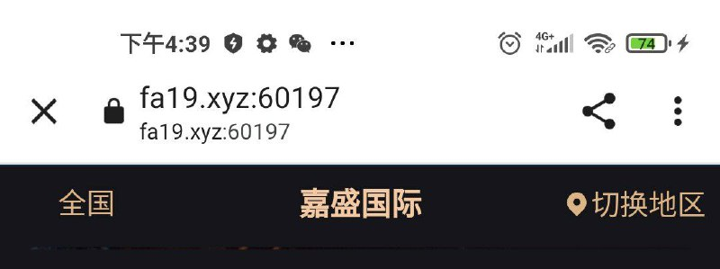
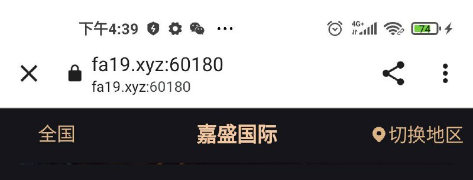
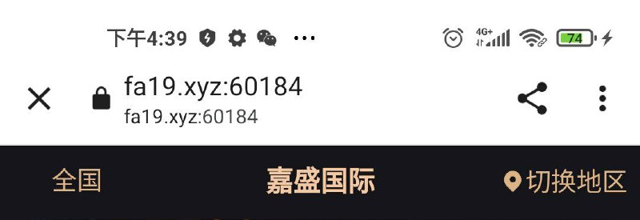

# 随机分配端口实现域名国内屏蔽

> GitHub 仓库源文件：[点击打开网页渲染版](https://github.com/ben2023niao/ben-ops-notes/blob/main/doc/md/202409191911-%E5%AE%89%E5%85%A8%E7%AB%9E%E8%B5%9B%E5%A4%8D%E7%9B%98%2BTelegram-%E9%9A%8F%E6%9C%BA%E5%88%86%E9%85%8D%E7%AB%AF%E5%8F%A3%E5%AE%9E%E7%8E%B0%E5%9F%9F%E5%90%8D%E5%9B%BD%E5%86%85%E8%AE%BF%E9%97%AE%E7%AD%96%E7%95%A5%E9%AA%8C%E8%AF%81.md)

> 原文：[随机分配端口实现域名国内屏蔽](https://ji-shu-jian-li.gitbook.io/ben_bird/sui-ji-fen-pei-duan-kou-shi-xian-yu-ming-guo-nei-ping-bi.html)

> 来源：GitBook 网页 HTML｜页面时间：2024-09-19 19:11｜日期依据：GitBook 页面更新时间

每个用户都分配一个单独的端口给这个用户，识别不出是真实用户的返回白色页面，并且这个端口只有这个当前用户能打开，再次进入后会销毁之前的端口再分配

[Telegram 原帖](https://t.me/HackerNiao/135538)

[Telegram 原帖](https://t.me/HackerNiao/135539)

[Telegram 原帖](https://t.me/HackerNiao/135540)

[Telegram 原帖](https://t.me/HackerNiao/135542)

