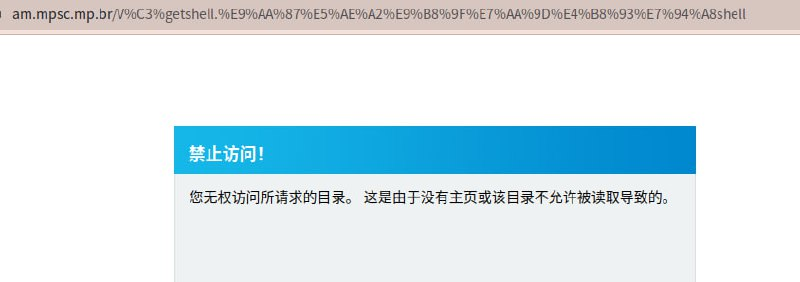
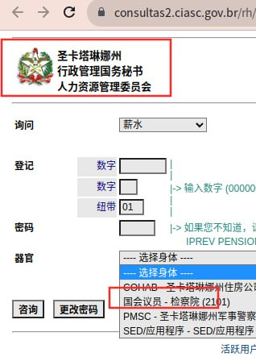
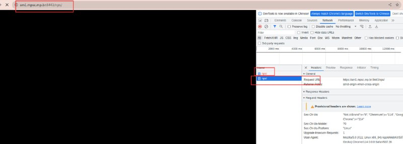
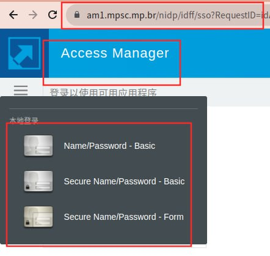
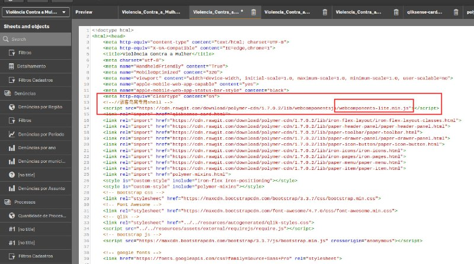
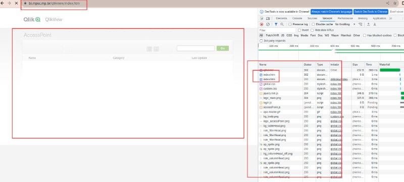
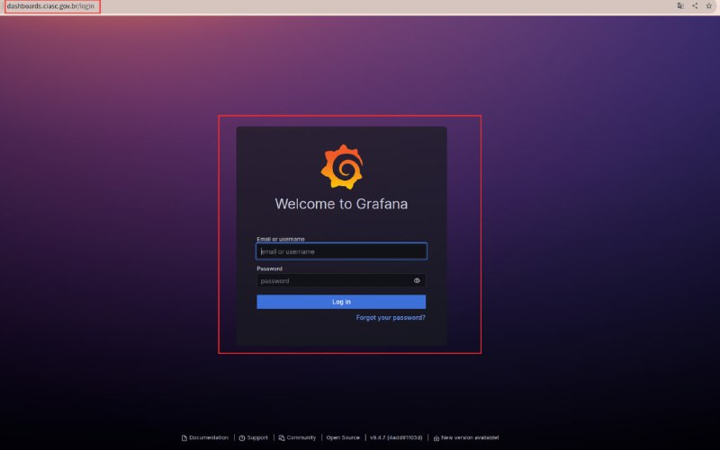
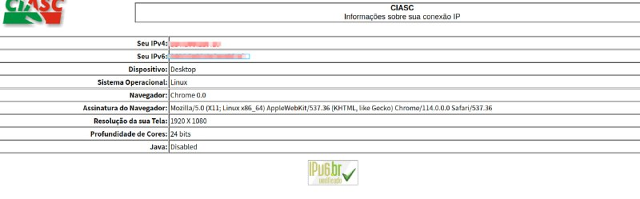

# 巴西网站批量入侵getshell

> GitHub 仓库源文件：[点击打开网页渲染版](https://github.com/ben2023niao/ben-ops-notes/blob/main/doc/md/202409191916-%E5%AE%89%E5%85%A8%E7%AB%9E%E8%B5%9B%E5%A4%8D%E7%9B%98%2BShell%2BTelegram-%E5%B7%B4%E8%A5%BF%E7%BD%91%E7%AB%99%E6%89%B9%E9%87%8F%E6%8E%88%E6%9D%83%E5%AE%89%E5%85%A8%E6%B5%8B%E8%AF%95%E5%91%BD%E4%BB%A4%E6%89%A7%E8%A1%8C%E9%A3%8E%E9%99%A9%E9%AA%8C%E8%AF%81.md)

> 原文：[巴西网站批量入侵getshell](https://ji-shu-jian-li.gitbook.io/ben_bird/ba-xi-wang-zhan-pi-liang-ru-qin-getshell.html)

> 来源：GitBook 网页 HTML｜页面时间：2024-09-19 19:16｜日期依据：GitBook 页面更新时间

[Telegram 原帖](https://t.me/HackerNiao/144969)

[Telegram 原帖](https://t.me/HackerNiao/145007)

[Telegram 原帖](https://t.me/HackerNiao/145001)

[Telegram 原帖](https://t.me/HackerNiao/144970)

[Telegram 原帖](https://t.me/HackerNiao/144975)

[Telegram 原帖](https://t.me/HackerNiao/144987)

[Telegram 原帖](https://t.me/HackerNiao/144979)

[Telegram 原帖](https://t.me/HackerNiao/145008)

[Telegram 原帖](https://t.me/HackerNiao/145015)

[Telegram 原帖](https://t.me/HackerNiao/144967)
