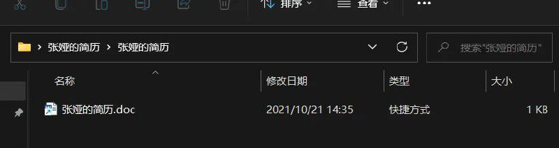

# 解压后看不到文件的恶意样本分析|不显示文件的恶意样本分析

> 原文：[解压后看不到文件的恶意样本分析|不显示文件的恶意样本分析](https://ji-shu-jian-li.gitbook.io/ben_bird/jie-ya-hou-kan-bu-dao-wen-jian-de-diao-yu-gong-ju-bao-bu-xian-shi-wen-jian-de-bing-du.html)

> 来源：GitBook 网页 HTML｜页面时间：2024-09-19 19:22｜日期依据：GitBook 页面更新时间

[Telegram 原帖](示例地址)

[Telegram 原帖](示例地址)

[Telegram 原帖](示例地址)

