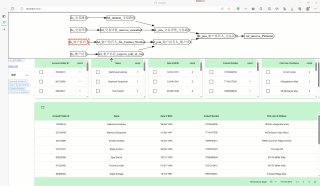
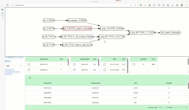

# python实现自动识别函数调用关系

> 原文：[python实现自动识别函数调用关系](https://ji-shu-jian-li.gitbook.io/ben_bird/python-shi-xian-zi-dong-shi-bie-han-shu-diao-yong-guan-xi.html)

> 来源：GitBook 网页 HTML｜页面时间：2024-09-19 19:25｜日期依据：GitBook 页面更新时间

[Telegram 原帖](https://t.me/HackerNiao/162519)

[Telegram 原视频 1](../media/3f88dd3ae1f9bc0933.mp4)

[Telegram 原帖](https://t.me/HackerNiao/162521)

[Telegram 原视频 1](../media/8db9f4448314fed06b.mp4)

