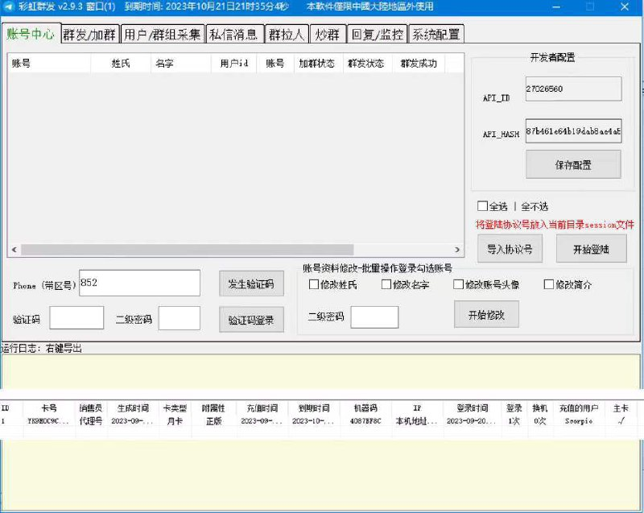

# 破解飞机群发软件

> 原文：[破解飞机群发软件](https://ji-shu-jian-li.gitbook.io/ben_bird/po-jie-fei-ji-qun-fa-ruan-jian.html)

> 来源：GitBook 网页 HTML｜页面时间：2024-09-19 19:26｜日期依据：GitBook 页面更新时间

[Telegram 原帖](https://t.me/HackerNiao/167151)

[Telegram 原帖](https://t.me/HackerNiao/167154)

