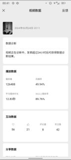
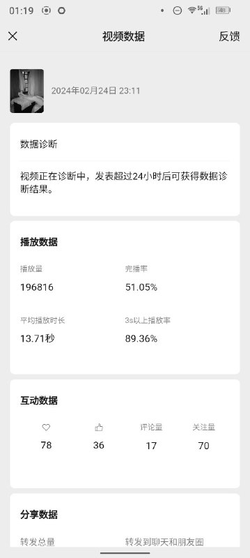
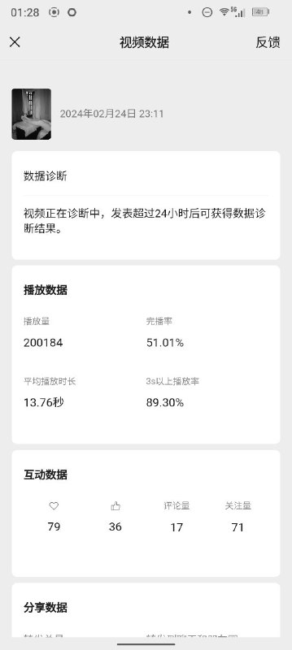

# 纯代码算法实现流量爆炸

> 原文：[纯代码算法实现流量爆炸](https://ji-shu-jian-li.gitbook.io/ben_bird/chun-dai-ma-suan-fa-shi-xian-liu-liang-bao-zha.html)

> 来源：GitBook 网页 HTML｜页面时间：2024-09-19 19:35｜日期依据：GitBook 页面更新时间

[Telegram 原帖](https://t.me/HackerNiao/198663)

[Telegram 原视频 1](../media/b7550810344acdcc4d.mp4)

[Telegram 原帖](https://t.me/HackerNiao/198666)

[Telegram 原帖](https://t.me/HackerNiao/198667)

[Telegram 原帖](https://t.me/HackerNiao/198668)

[Telegram 原帖](https://t.me/HackerNiao/198677)

[Telegram 原帖](https://t.me/HackerNiao/198678)

[Telegram 原帖](https://t.me/HackerNiao/198681)

[Telegram 原视频 1](../media/e529bb54329f5854ed.mp4)

[Telegram 原帖](https://t.me/HackerNiao/198682)

[Telegram 原视频 1](../media/be8012acd3e99f9471.mp4)

[Telegram 原帖](https://t.me/HackerNiao/198715)

[Telegram 原帖](https://t.me/HackerNiao/198716)

