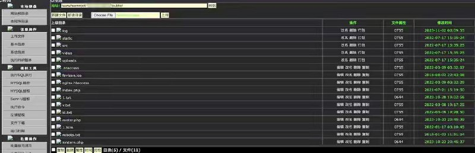
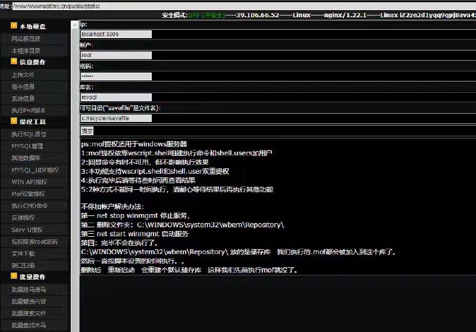
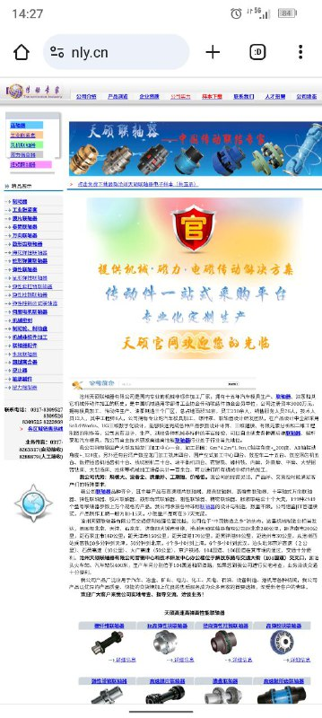

# https://nly.cn 网站拿下

> 原文：[https://nly.cn 网站拿下](https://ji-shu-jian-li.gitbook.io/ben_bird/httpsnly.cn-wang-zhan-na-xia.html)

> 来源：GitBook 网页 HTML｜页面时间：2024-09-19 19:36｜日期依据：GitBook 页面更新时间

[Telegram 原帖](https://t.me/HackerNiao/232298)

[Telegram 原帖](https://t.me/HackerNiao/232299)

[Telegram 原帖](https://t.me/HackerNiao/232301)

