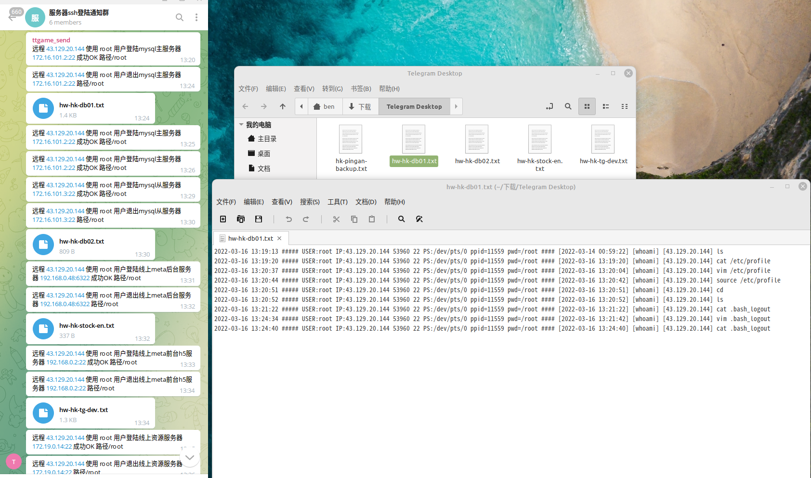

# ssh 登录/登出监控和操作记录实现

> 原文：[ssh 登录/登出监控和操作记录实现](https://ji-shu-jian-li.gitbook.io/ben_bird/ssh-deng-lu-deng-chu-jian-kong-he-cao-zuo-ji-lu-shi-xian.html)

> 来源：GitBook 网页 HTML｜页面时间：2024-09-19 19:55｜日期依据：GitBook 页面更新时间

#### ssh 登录/登出监控和操作记录实现

[

ssh 登录/登出监控 | 运维xn--6o0a585a.gitbook.io](示例地址)
