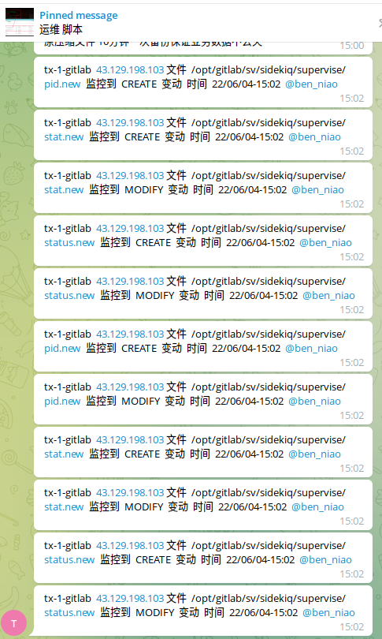

# 服务器文件变动监控实现

> 原文：[服务器文件变动监控实现](https://ji-shu-jian-li.gitbook.io/ben_bird/fu-wu-qi-wen-jian-bian-dong-jian-kong-shi-xian.html)

> 来源：GitBook 网页 HTML｜页面时间：2024-09-19 19:56｜日期依据：GitBook 页面更新时间

#### 服务器文件变动监控实现

[

文件变动监控 | 运维xn--6o0a585a.gitbook.io](示例地址)
