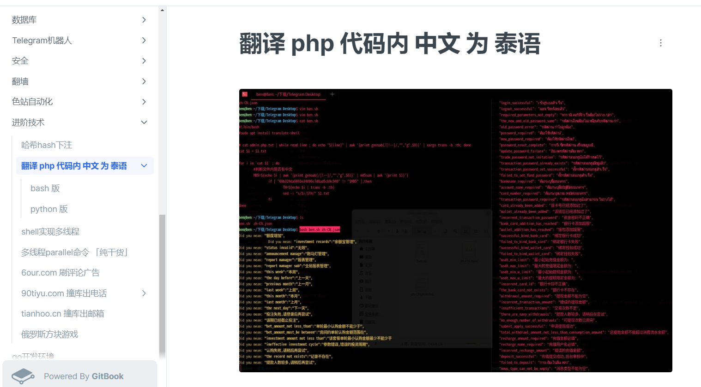

# AG的国际数字站外挂聊天和论坛的架构改进 k8.io

> 原文：[AG的国际数字站外挂聊天和论坛的架构改进 k8.io](https://ji-shu-jian-li.gitbook.io/ben_bird/ag-de-guo-ji-shu-zi-zhan-wai-gua-liao-tian-he-lun-tan-de-jia-gou-gai-jin-k8.io.html)

> 来源：GitBook 网页 HTML｜页面时间：2024-09-19 20:00｜日期依据：GitBook 页面更新时间

**AG的国际数字站外挂聊天和论坛的架构改进** [**k8.io**](https://k8.io/)

**（虚拟机微服务改k8s）**

**AG尊龙凯时老盘项目优化改造** [**z6.com**](https://z6.com/)

**盘口老项目无法做多语言下写脚本实现自动化翻译代码内中文**

[

翻译 php 代码内 中文 为 泰语 | 运维xn--6o0a585a.gitbook.io](https://xn--6o0a585a.gitbook.io/devops/jin-jie-ji-shu/fan-yi-php-dai-ma-nei-zhong-wen-wei-tai-yu)
