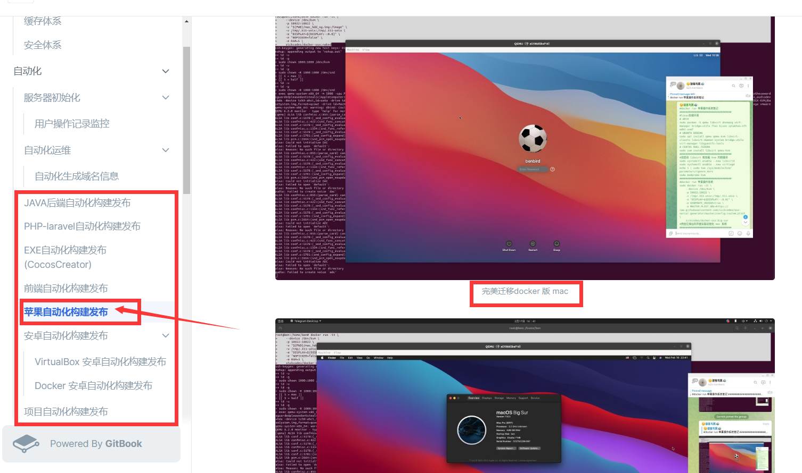

# 突破苹果打包必须要苹果电脑的xcode的尴尬

> 原文：[突破苹果打包必须要苹果电脑的xcode的尴尬](https://ji-shu-jian-li.gitbook.io/ben_bird/tu-po-ping-guo-da-bao-bi-xu-yao-ping-guo-dian-nao-de-xcode-de-gan-ga.html)

> 来源：GitBook 网页 HTML｜页面时间：2024-09-19 20:01｜日期依据：GitBook 页面更新时间

#### 突破苹果打包必须要苹果电脑的xcode的尴尬

docker技术方式实现任意电脑任意操作系统上跑mac的容器并配置好xcode打包环境

[https://运维.gitbook.io/devops/zi-dong-hua/ping-guo-zi-dong-hua-gou-jian-fa-bu](https://xn--6o0a585a.gitbook.io/devops/zi-dong-hua/ping-guo-zi-dong-hua-gou-jian-fa-bu)
