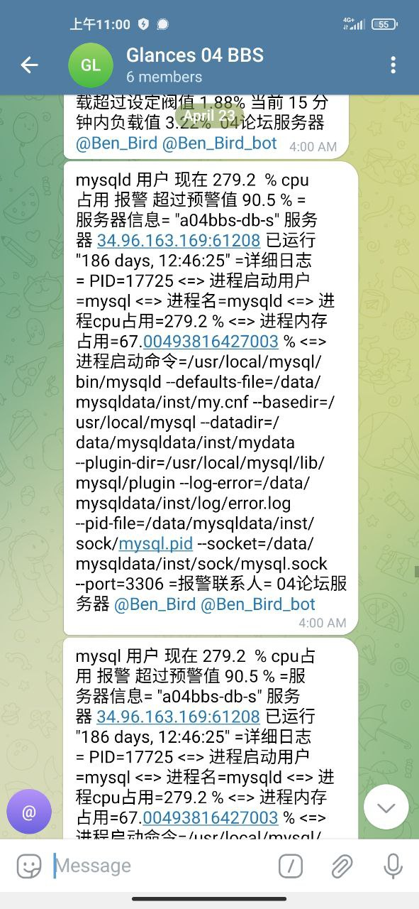
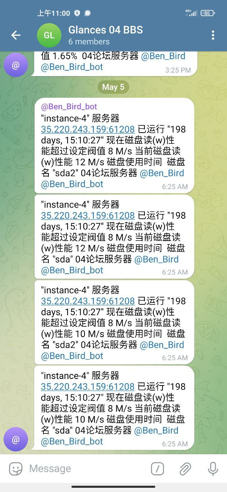
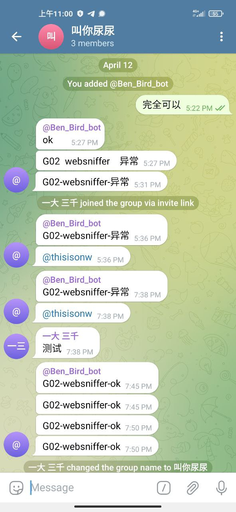

# 根据业务接口api和k8s系统接口二开的监控报警

> GitHub 仓库源文件：[点击打开网页渲染版](https://github.com/ben2023niao/ben-ops-notes/blob/main/doc/md/202409192002-%E5%AE%89%E5%85%A8%E7%AB%9E%E8%B5%9B%E5%A4%8D%E7%9B%98%2BKubernetes%2BMySQL-%E6%A0%B9%E6%8D%AE%E4%B8%9A%E5%8A%A1%E6%8E%A5%E5%8F%A3api%E5%92%8Ck8s%E7%B3%BB%E7%BB%9F%E6%8E%A5%E5%8F%A3%E4%BA%8C%E5%BC%80%E7%9A%84%E7%9B%91%E6%8E%A7%E6%8A%A5%E8%AD%A6.md)

> 原文：[根据业务接口api和k8s系统接口二开的监控报警](https://ji-shu-jian-li.gitbook.io/ben_bird/gen-ju-ye-wu-jie-kou-api-he-k8s-xi-tong-jie-kou-er-kai-de-jian-kong-bao-jing.html)

> 来源：GitBook 网页 HTML｜页面时间：2024-09-19 20:02｜日期依据：GitBook 页面更新时间

**根据业务接口api和k8s系统接口二开的监控报警**

mysql详细进程级别报警

k8s接口实现

业务系统特殊逻辑需要的监控
