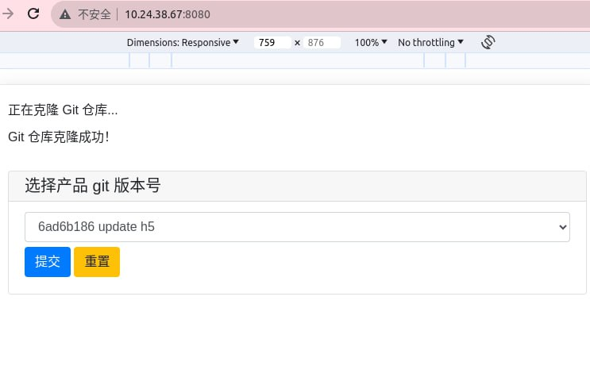
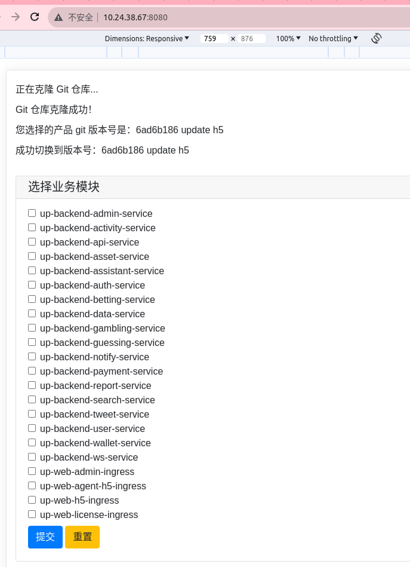
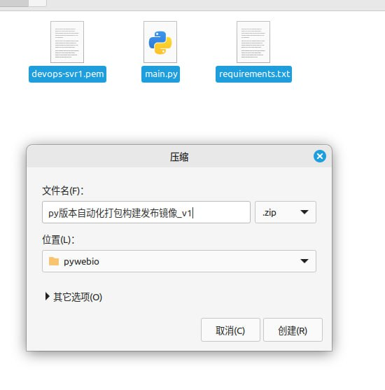

# python 实现 node java php vue 页面模块自动化打包上线到k8s 不同环境

> GitHub 仓库源文件：[点击打开网页渲染版](https://github.com/ben2023niao/ben-ops-notes/blob/main/doc/md/202409192007-%E5%AE%89%E5%85%A8%E7%AB%9E%E8%B5%9B%E5%A4%8D%E7%9B%98%2BPython%2BKubernetes-python%20%E5%AE%9E%E7%8E%B0%20node%20java%20php%20vue%20%E9%A1%B5%E9%9D%A2%E6%A8%A1%E5%9D%97%E8%87%AA%E5%8A%A8%E5%8C%96%E6%89%93%E5%8C%85%E4%B8%8A%E7%BA%BF%E5%88%B0k8s%20%E4%B8%8D%E5%90%8C%E7%8E%AF%E5%A2%83.md)

> 原文：[python 实现 node java php vue 页面模块自动化打包上线到k8s 不同环境](https://ji-shu-jian-li.gitbook.io/ben_bird/python-shi-xian-node-java-php-vue-ye-mian-mo-kuai-zi-dong-hua-da-bao-shang-xian-dao-k8s-bu-tong-huan.html)

> 来源：GitBook 网页 HTML｜页面时间：2024-09-19 20:07｜日期依据：GitBook 页面更新时间

