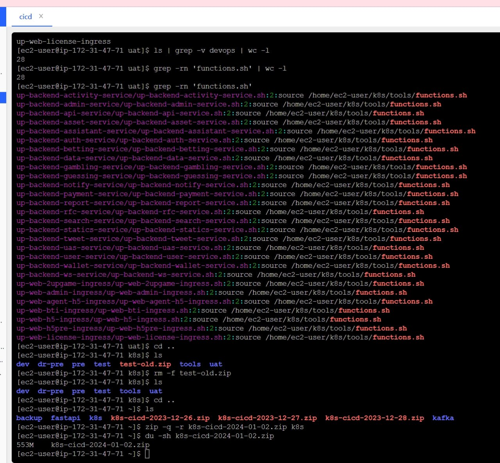

# 自动化打包部署业务模块到k8s脚本编写

> 原文：[自动化打包部署业务模块到k8s脚本编写](https://ji-shu-jian-li.gitbook.io/ben_bird/zi-dong-hua-da-bao-bu-shu-ye-wu-mo-kuai-dao-k8s-jiao-ben-bian-xie.html)

> 来源：GitBook 网页 HTML｜页面时间：2024-09-19 20:25｜日期依据：GitBook 页面更新时间

```
main() {
    set_var               #设置环境变量检查脚本
    check_file_extension  #检查文件格式
    git_clone             #拉取对应环境对应模块代码
    build_docker_image    #打包模块代码和对应的配置环境变量成docker镜像
    push_docker_image     #推送镜像到对应环境的仓库
    update_helm_chart     #生成部署的helm的yaml配置和更新helm的tag
    deploy_to_env         #部署模块到k8s环境 使用的 argo
    clean_docker_images   #清理镜像部署过程中产生的垃圾
    local result=$? ; echo "函数 $FUNCNAME 执行后返回 $result" ; return "$result"
}
main
```


