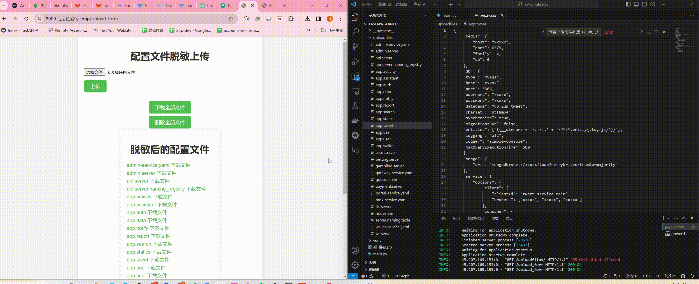

# 线上配置文件脱敏工具编写

> 原文：[线上配置文件脱敏工具编写](https://ji-shu-jian-li.gitbook.io/ben_bird/xian-shang-pei-zhi-wen-jian-tuo-min-gong-ju-bian-xie.html)

> 来源：GitBook 网页 HTML｜页面时间：2024-09-19 20:29｜日期依据：GitBook 页面更新时间

[

TelegramTelegram](示例地址)
