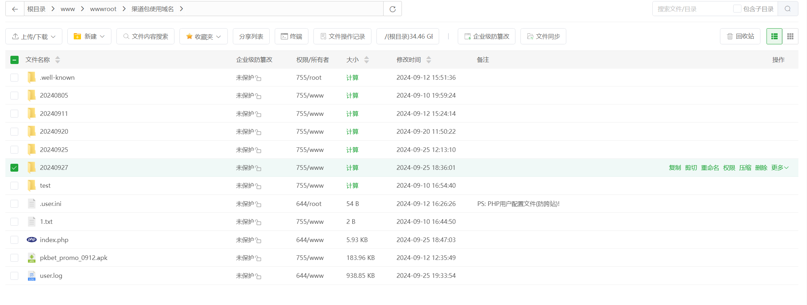
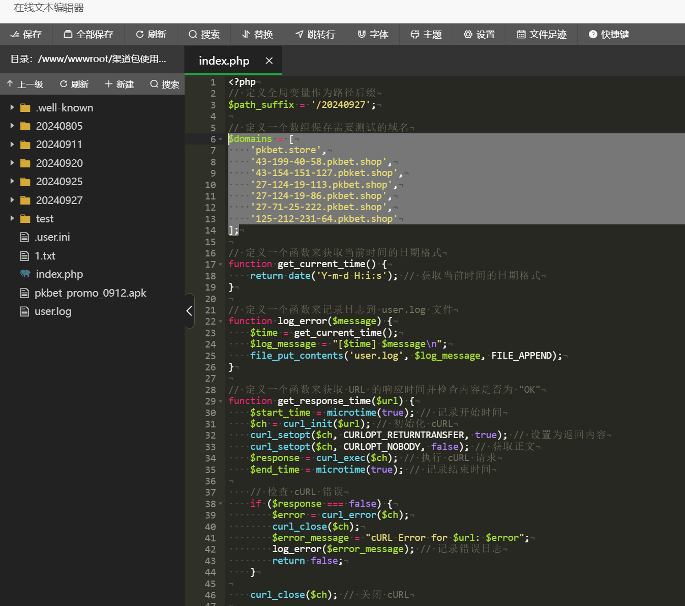
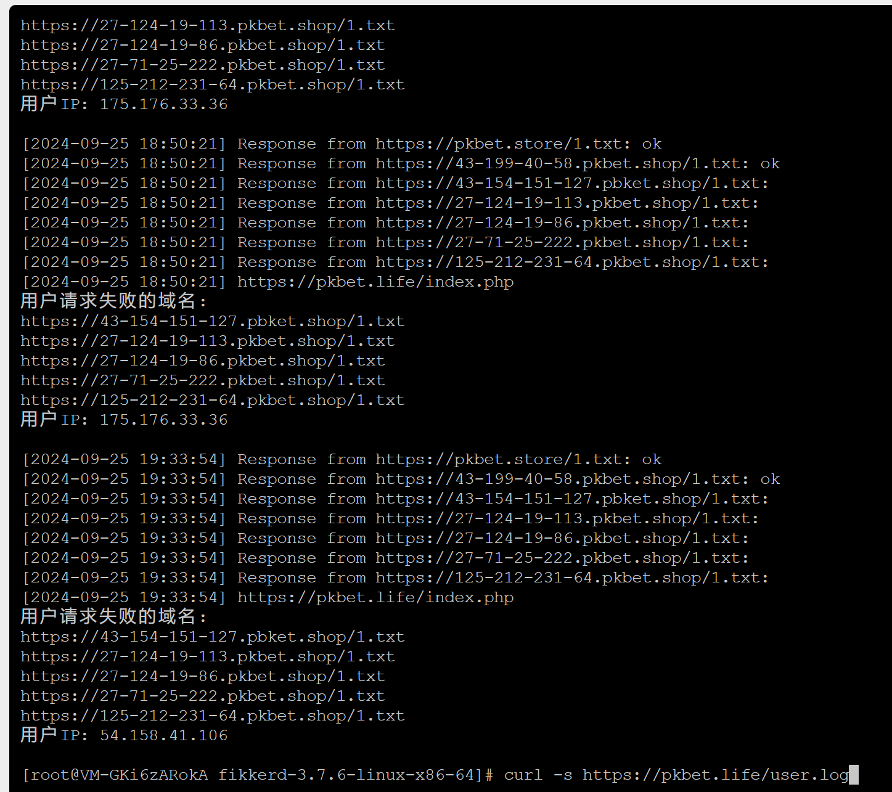

# 落地页面网络线路逻辑优化

> 原文：[落地页面网络线路逻辑优化](https://ji-shu-jian-li.gitbook.io/ben_bird/luo-di-ye-mian-wang-luo-xian-lu-luo-ji-you-hua.html)

> 来源：GitBook 网页 HTML｜页面时间：2024-09-25 04:16｜日期依据：正文原始日期

```
pkbet.win
pkbet.top
pkbet.today

pkbet.life
pkbet.shop
[测试号码已脱敏].pkbet.shop
[测试号码已脱敏].pkbet.shop
[测试号码已脱敏].pkbet.shop
[测试号码已脱敏].pkbet.shop
[测试号码已脱敏].pkbet.shop
[测试号码已脱敏].pkbet.shop
[测试号码已脱敏].pbket.shop

pkbet.store

这些单独访问都会请求到
index.php
这里进行 域名/1.txt 内容是不是ok 来判断最快的域名返回给用户打开
然后路由分配最好的能通的域名上去打开最新的前端代码目录
```

实现用户请求多不同CDN渠道域名访问 域名/1.txt 内容是不是ok 来判断最快的域名返回给用户打开到最新的前端代码目录实现没缓存影响的快速打开







curl -s 示例地址


[pkbet.win_20240925_041603.tar.gz](示例地址)14MB[Open](示例地址)[pkbet.life_20240925_041541.tar.gz](示例地址)19MB[Open](示例地址)
