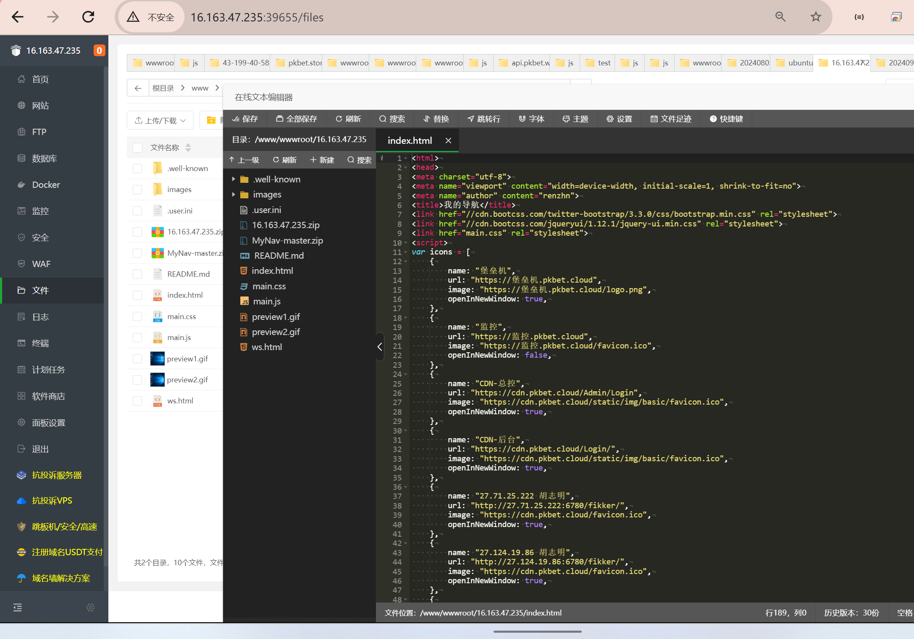

# 工作导航页编写

> GitHub 仓库源文件：[点击打开网页渲染版](https://github.com/ben2023niao/ben-ops-notes/blob/main/doc/md/202409251219-%E5%AE%89%E5%85%A8%E7%AB%9E%E8%B5%9B%E5%A4%8D%E7%9B%98%2B%E5%B7%A5%E7%A8%8B%E7%AC%94%E8%AE%B0-%E5%B7%A5%E4%BD%9C%E5%AF%BC%E8%88%AA%E9%A1%B5%E7%BC%96%E5%86%99.md)

> 原文：[工作导航页编写](https://ji-shu-jian-li.gitbook.io/ben_bird/gong-zuo-dao-hang-ye-bian-xie.html)

> 来源：GitBook 网页 HTML｜页面时间：2024-09-25 12:19｜日期依据：正文原始日期

[16.163.47.235_20240925_121930.tar.gz](https://223452648-files.gitbook.io/~/files/v0/b/gitbook-x-prod.appspot.com/o/spaces%2FsSk3NOIHInyaEoVplYCL%2Fuploads%2FCABXSsrnkxwCERzYPG4G%2F16.163.47.235_20240925_121930.tar.gz?alt=media&token=[已脱敏]
