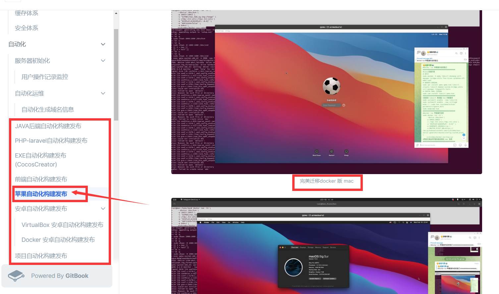

# 突破苹果打包必须要苹果电脑的xcode的尴尬

> 原文：[突破苹果打包必须要苹果电脑的xcode的尴尬](https://ji-shu-jian-li.gitbook.io/ben_bird/tu-po-ping-guo-da-bao-bi-xu-yao-ping-guo-dian-nao-de-xcode-de-gan-ga.md)

> 归档性质：比赛结束后的授权安全演练复盘；正文中的凭据和联系信息已脱敏，图片保留比赛复盘原帖。

#### 突破苹果打包必须要苹果电脑的xcode的尴尬 

docker技术方式实现任意电脑任意操作系统上跑mac的容器并配置好xcode打包环境

[示例地址)

 
