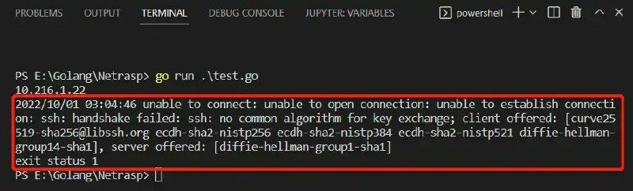
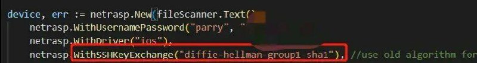
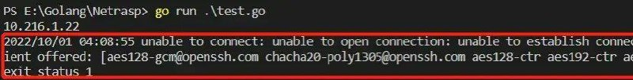
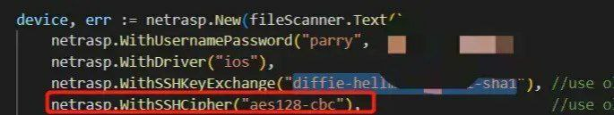

# golang 解决古董思科设备ssh验证算法不兼容故障

> 原文：[golang 解决古董思科设备ssh验证算法不兼容故障](https://ji-shu-jian-li.gitbook.io/ben_bird/golang-jie-jue-gu-dong-si-ke-she-bei-ssh-yan-zheng-suan-fa-bu-jian-rong-gu-zhang.md)

> 归档性质：比赛结束后的授权安全演练复盘；正文中的凭据和联系信息已脱敏，图片保留比赛复盘原帖。

