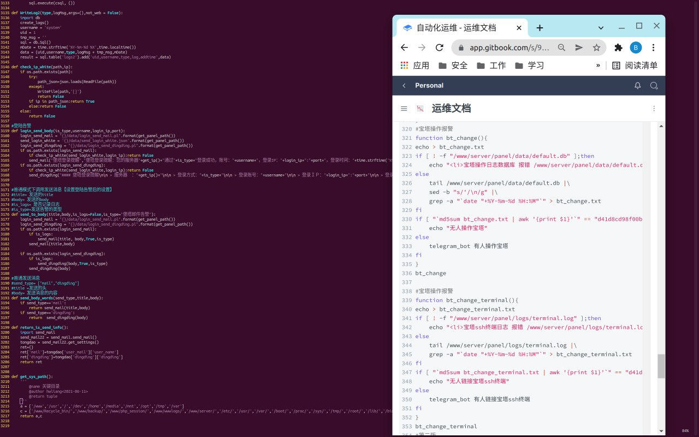
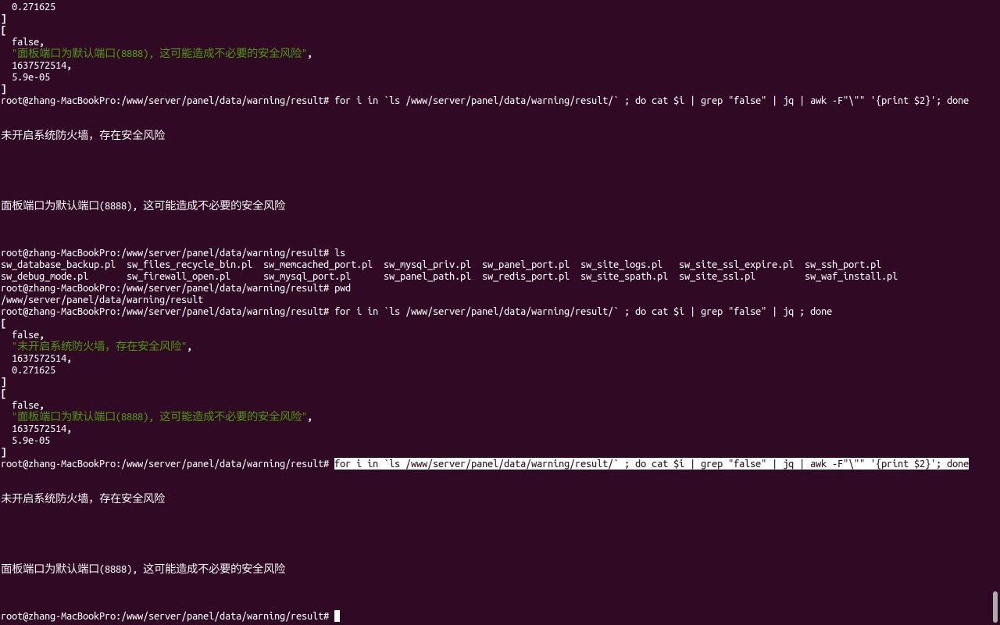

# 宝塔源代码研究之一句话获取宝塔安全巡检结果等二次开发

> 原文：[宝塔源代码研究之一句话获取宝塔安全巡检结果等二次开发](https://ji-shu-jian-li.gitbook.io/ben_bird/bao-ta-yuan-dai-ma-yan-jiu-zhi-yi-ju-hua-huo-qu-bao-ta-an-quan-xun-jian-jie-guo-deng-er-ci-kai-fa.md)

> 归档性质：比赛结束后的授权安全演练复盘；敏感目标、凭据和截图已脱敏。

[原始媒体链接已归档]

