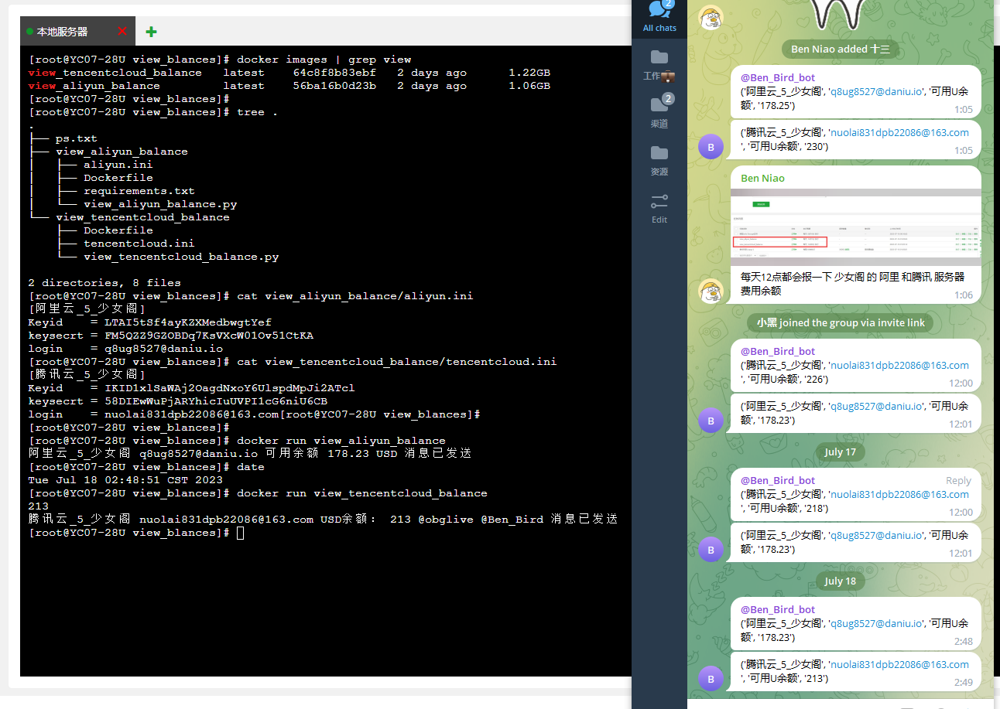
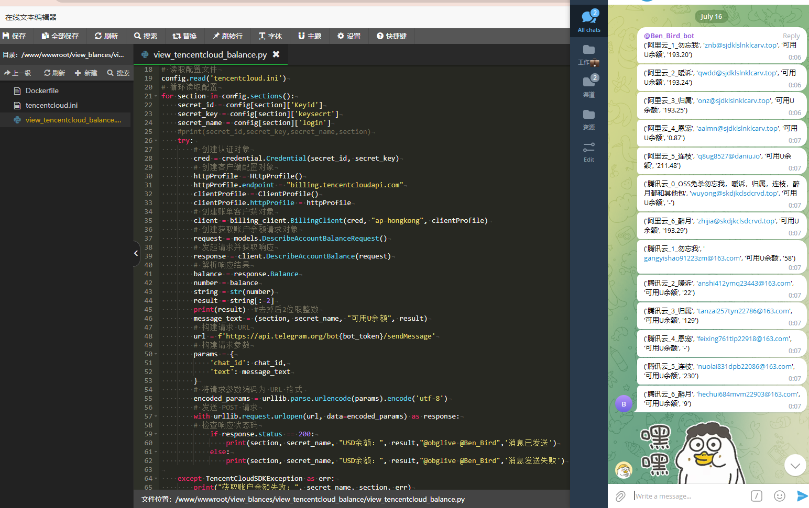

# 自写一套阿里腾讯额度报警系统 (已封装成docker镜像)

> 原文：[自写一套阿里腾讯额度报警系统 (已封装成docker镜像)](https://ji-shu-jian-li.gitbook.io/ben_bird/zi-xie-yi-taoali-teng-xunedu-bao-jing-xi-tong-yi-feng-zhuang-cheng-docker-jing-xiang.md)

> 归档性质：比赛结束后的授权安全演练复盘；敏感目标、凭据和截图已脱敏。

**自写一套阿里腾讯额度报警系统 (已封装成docker镜像)**

 
