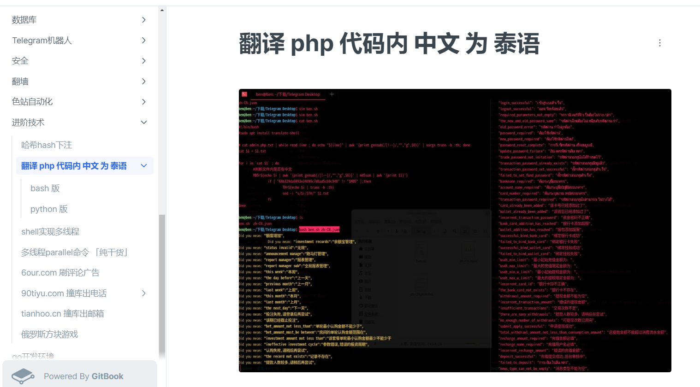

# 某业务平台的国际数字站外挂聊天和论坛的架构改进 k8.io

> 原文：[某业务平台的国际数字站外挂聊天和论坛的架构改进 k8.io](https://ji-shu-jian-li.gitbook.io/ben_bird/ag-de-guo-ji-shu-zi-zhan-wai-gua-liao-tian-he-lun-tan-de-jia-gou-gai-jin-k8.io.md)

> 归档性质：比赛结束后的授权安全演练复盘；敏感目标、凭据和截图已脱敏。

**某业务平台的国际数字站外挂聊天和论坛的架构改进** [**k8.io**](示例地址)

**（虚拟机微服务改k8s）**

**某业务平台老盘项目优化改造** [**目标示例**](示例地址)

**盘口老项目无法做多语言下写脚本实现自动化翻译代码内中文**



[原始媒体链接已归档]

<br>

```bash
#!/bin/bash
#sudo apt install translate-shell
cat $1 > $1.txt
for i in `cat $1` ; do
  MD5=$(echo $i | awk '{print gensub(/[!-~]/,"","g",$0)}' | md5sum | awk '{print $1}')
    if [ "68b329da9893e34099c7d8ad5cb9c940" != "$MD5" ];then   #判断是中文就翻译
      TH=$(echo $i | trans -b :th) #翻译为泰语
      PH=$(echo $i | trans -b :ph) #翻译为菲语
      sed -i "s/$i/$TH/" $1.txt
    fi
done
```

```python
import hashlib
import random
import re
import time
import requests
import os

# 百度api
apiurl = '示例地址
appid = '202*******9' # 百度翻译api的appid
敏感凭据：[已脱敏] # 百度翻译api的secretKey

# 查找文本中的中文字符，并将连续的中文字符以列表返回
def find_chinese(text):
    regStr = ".*?([一-龥]+).*?"
    aa = re.findall(regStr, text)
    return aa

# 翻译内容 源语言 翻译后的语言  泰语 th
def translateBaidu(content, fromLang='zh', toLang='th'):
    salt = str(random.randint(32768, 65536))
    sign = appid + content + salt + secretKey  # appid+q+salt+密钥 的MD5值
    sign = hashlib.md5(sign.encode("utf-8")).hexdigest()  # 对sign做md5，得到32位小写的sign
    try:
        # 根据技术手册中的接入方式进行设定
        paramas = {
            'appid': appid,
            'q': content,
            'from': fromLang,
            'to': toLang,
            'salt': salt,
            'sign': sign
        }
        response = requests.get(apiurl, paramas)
        jsonResponse = response.json()  # 获得返回的结果，结果为json格式
        dst = str(jsonResponse["trans_result"][0]["dst"])  # 取得翻译后的文本结果
        return dst
    except Exception as e:
        print(e)

# 读取文件，翻译成泰语，返回一个翻译好的文档的每行的list
def text_deal(filename, fromLang='zh', toLang='th'):
    '''
    读取文件，翻译成泰语，返回一个翻译好的文档的每行的list
    :param filename: 翻译的文档路径
    :return: 翻译好的每行的list
    '''
    file = open(filename, encoding="utf-8")
    while 1:
        lines = file.readlines(100000)
        if not lines:
            break
        # 遍历每一行代码
        i = 0
        newline = []
        for line in lines:
            i += 1
            linea = line.lstrip()  # 去除了左方空行
            # 判断是否是注释，是注释则跳过
            if linea[0:2] == "//" or linea[0:4] == "<!--":
                newline.append(line)
                continue
            # 查找中文字符
            chineses = find_chinese(linea)
            if chineses:
                print("[" + str(i) + "]: ", linea)
                # 查找到中文字符，并调用翻译api翻译进行字符串替换
                for c in chineses:
                    time.sleep(2)
                    translate_str = translateBaidu(c, fromLang, toLang)
                    line = line.replace(c, translate_str)
                    print(c + " ----> " + translate_str)
            newline.append(line)
    file.close()
    return newline

# 调用函数处理文档
files = os.listdir("./translate")
for file in files:
    print("=====================")
    print("正在处理文件：" + file)
    newlines = text_deal("./translate/" + file, "zh", "th")
    fw = open("./translated/" + file, "a",encoding="utf-8")
    for l in newlines:
        fw.write(l)
    fw.close()
```
