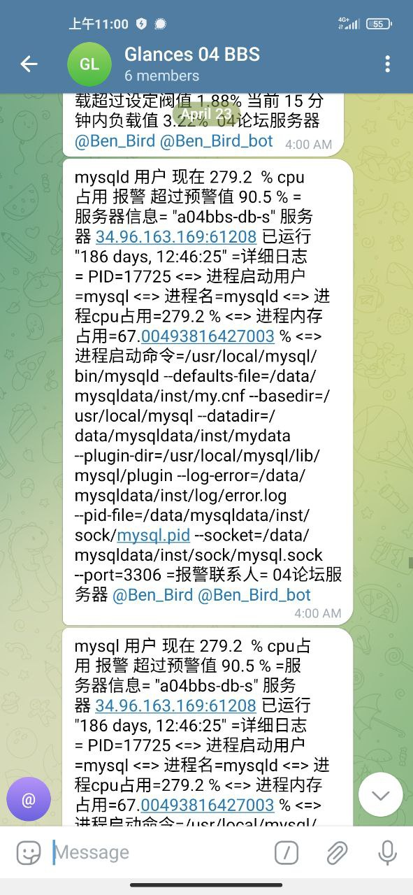
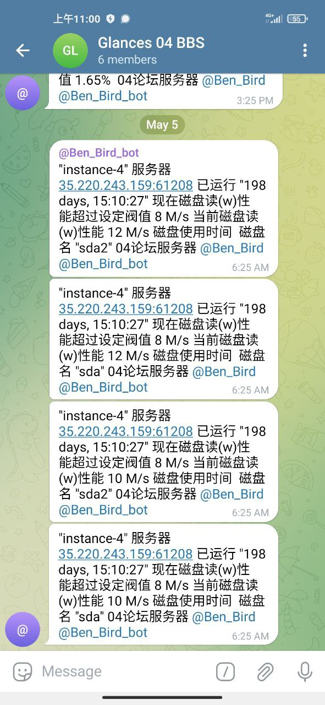
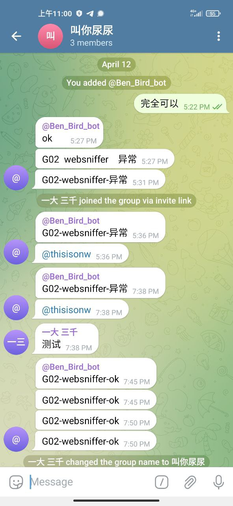

# 根据业务接口api和k8s系统接口二开的监控报警

> 原文：[根据业务接口api和k8s系统接口二开的监控报警](https://ji-shu-jian-li.gitbook.io/ben_bird/gen-ju-ye-wu-jie-kou-api-he-k8s-xi-tong-jie-kou-er-kai-de-jian-kong-bao-jing.md)

> 归档性质：比赛结束后的授权安全演练复盘；正文中的凭据和联系信息已脱敏，图片保留比赛复盘原帖。

**根据业务接口api和k8s系统接口二开的监控报警**

