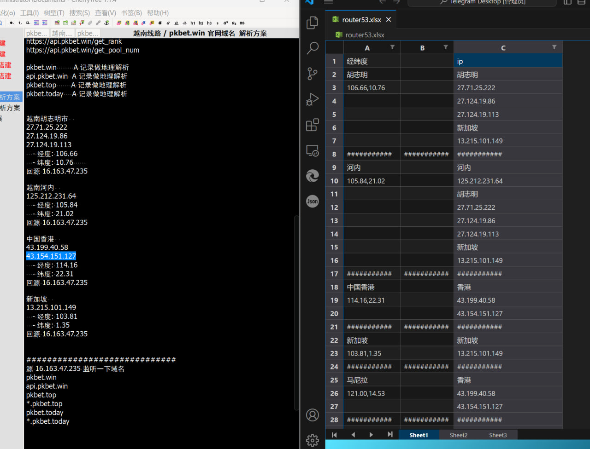
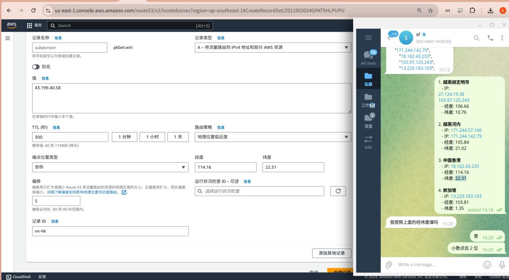
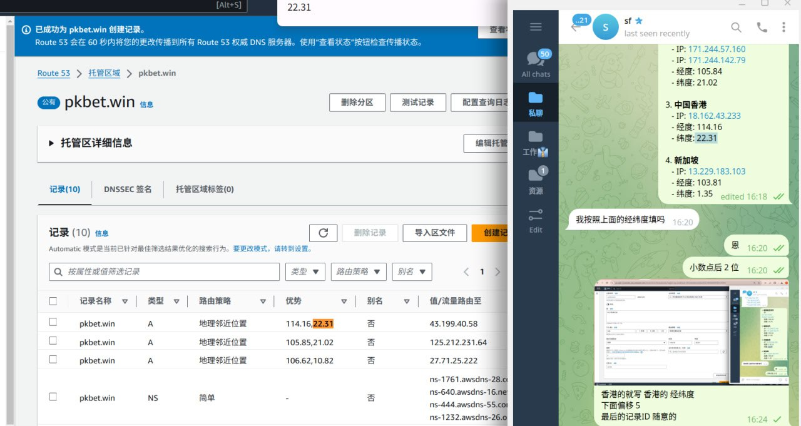

# 域名基于经纬度做区域解析优化

> 原文：[域名基于经纬度做区域解析优化](https://ji-shu-jian-li.gitbook.io/ben_bird/yu-ming-ji-yu-jing-wei-du-zuo-qu-yu-jie-xi-you-hua.md)

> 归档性质：比赛结束后的授权安全演练复盘；敏感目标、凭据和截图已脱敏。

越南 和 巴西 分别部署搭建了cdn服务器的情况下实现 不同国家城市用户访问域名解析到地理位置最近的 本地搭建的CDN 节点服务器上

一个地区最少 2个节点 这样 AWS 会自动化解析到延迟最小的 节点，如果这个地区的节点都挂了 会解析最近的其它地区的节点IP，这样也能把 抗压能力测试 授权安全测试缩小到 挨着授权安全测试者最近的地区，授权安全测试着只是感觉访问不了，实际是就他哪个地区访问不了，这样也隔开了授权安全测试，一般我们都会在被授权安全测试的节点上 做 203.0.113.1 的临时解析反弹授权安全测试

1. 越南胡志明市
   * IP: 203.0.113.1\
     203.0.113.1
   * 经度: 106.66
   * 纬度: 10.76
2. 越南河内
   * IP: 203.0.113.1
   * IP: 203.0.113.1
   * 经度: 105.84
   * 纬度: 21.02
3. 中国香港
   * IP: 203.0.113.1
   * 经度: 114.16
   * 纬度: 22.31
4. 新加坡
   * IP: 203.0.113.1
   * 经度: 103.81
   * 纬度: 1.35
5. 马尼拉市:
   * 纬度: 14.5995° N
   * 经度: 120.9842° E
6. 奎松市:
   * 纬度: 14.6760° N
   * 经度: 121.0437° E
7. 马卡蒂市:
   * 纬度: 14.5566° N
   * 经度: 121.0234° E
8. 加洛坎市:
   * 纬度: 14.7566° N
   * 经度: 120.9927° E
9. 帕拉尼亚克市:
   * 纬度: 14.4793° N
   * 经度: 121.0198° E
10. 帕赛市:
    * 纬度: 14.5378° N
    * 经度: 121.0014° E
