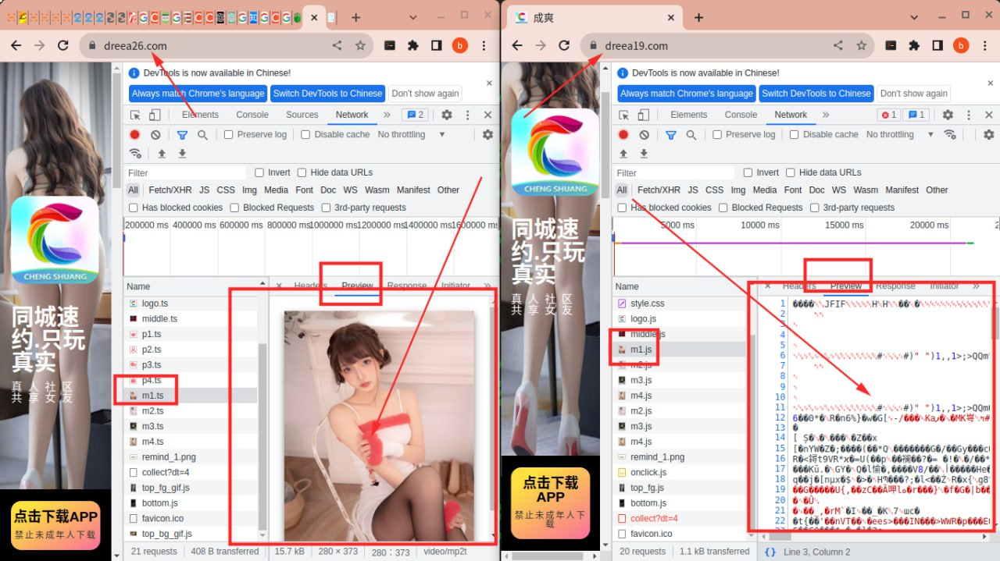
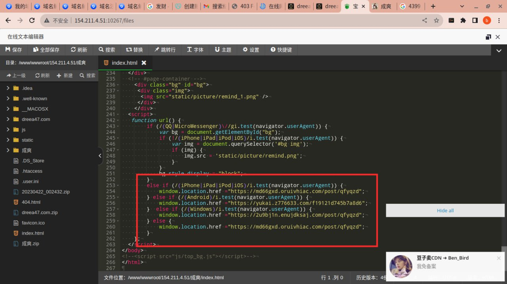
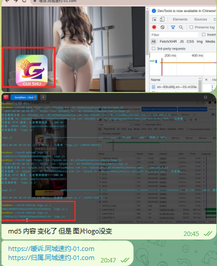
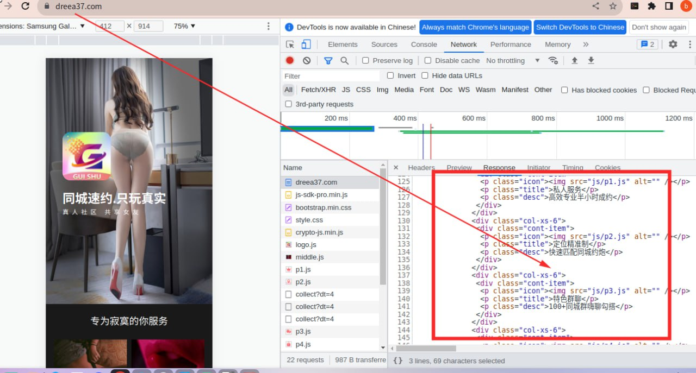
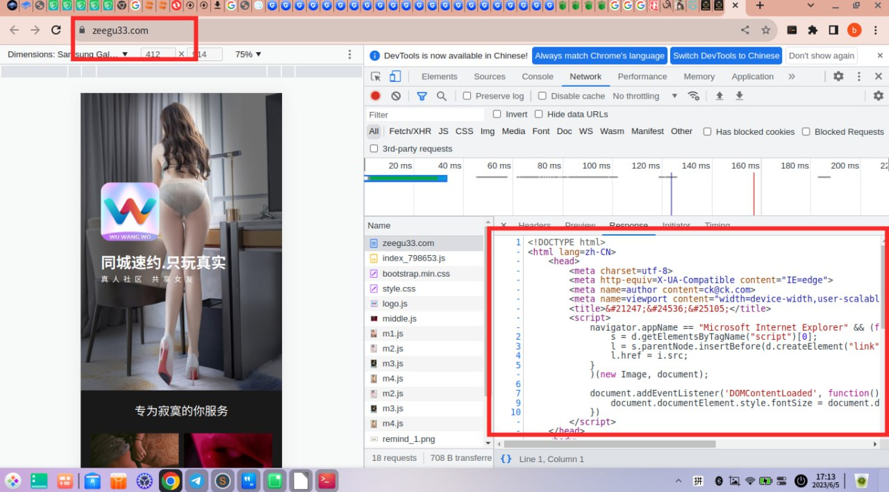
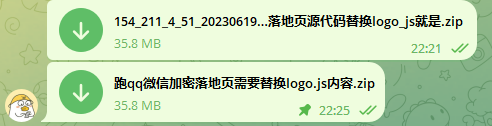

# 微信 QQ内打开娱乐业务和内容展示页面实现

> 原文：[微信 QQ内打开娱乐业务和内容展示页面实现](https://ji-shu-jian-li.gitbook.io/ben_bird/wei-xin-qq-nei-da-kai-bo-cai-he-se-qing-wang-ye-shi-xian.md)

> 归档性质：比赛结束后的授权安全演练复盘；正文中的凭据和联系信息已脱敏，图片保留比赛复盘原帖。

#### 微信 QQ内打开娱乐业务和内容展示页面实现 

基于自建cdn 图片加密 汉字加密 代码加密 技术

<示例地址>

右边是加密好的 浏览器 按f12都显示图是一堆乱码

<示例地址>

左边是没有加密的 浏览器 按f12会显示图出来所以跑不了敏感图片在微信qq

**自己一步一步实现的能稳定跑qq和微信的落地页代码，跑其它项目换换图片和文字然后重新加密就是**
